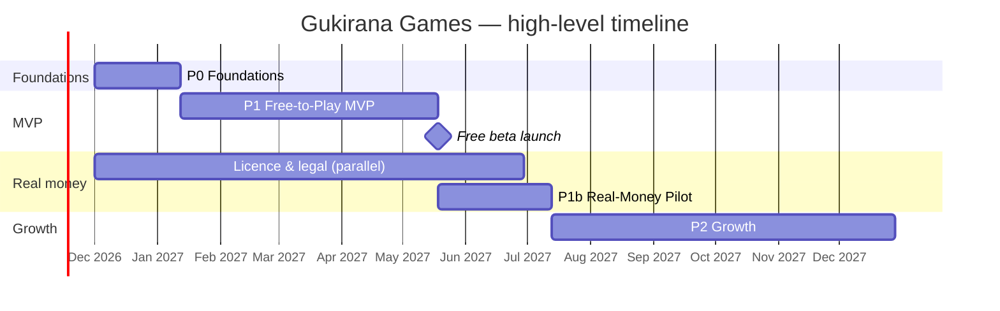

# Implementation Plan — Gukirana Games

| Item | Value |
|---|---|
| Document | Phased Implementation Plan (engineering) |
| Version | 1.0 |
| Date | 12 November 2026 |
| Sources | [SRS.md](SRS.md) v1.4 · [DESIGN-SPEC-3D-VR.md](DESIGN-SPEC-3D-VR.md) v1.0 |
| Audience | Engineers, tech leads, QA, DevOps, project managers, and **Claude Code** |
| Status | Baseline plan, updated at the end of every sprint |

---

## 0. How to Use This Document

### 0.1 For developers
- Work is split into **Phases → Epics → Tasks**. Each task has a stable ID like `P1-WLD-04` (Phase 1, epic WLD, task 04).
- Every task lists: **what to build**, **where (paths)**, **depends on**, **estimate** (ideal dev-days), **refs** (SRS / Design-spec IDs) and **acceptance criteria (AC)**.
- **One task = one pull request** (big tasks may be split into `P1-WLD-04a`, `04b`).
- Status is tracked with the checkboxes in this file **and** in the issue tracker (the issue title starts with the task ID).

### 0.2 For Claude Code
- Read **§2 (locked decisions)**, **§3 (repo structure)** and **§4 (conventions)** before any task. They are the rules.
- Pick a task by ID. Read its refs in the SRS / design spec, then implement **only that task's scope**.
- Before saying a task is finished, run `pnpm verify` (lint + typecheck + unit tests) and the task's AC checks. Never mark a checkbox done if any AC fails.
- **Hard rules** (never break them): see [§4.3 Money rules](#43-money-rules-non-negotiable) and [§4.4 Fairness rules](#44-fairness-rules-non-negotiable).
- Prompt template: [§13.2](#132-prompt-template-for-a-task).

### Progress log
| Date | Delivered | Notes |
|---|---|---|
| 2026-11-13 | **P0 foundations (part 1)**: monorepo, apps, shared packages, CI, ADRs; `money` (fees), `fairness` (browser + server RNG), `game-kit`, Drizzle ledger schema | Ticked tasks below |
| 2026-11-13 | **P1 vertical slice (playable, practice mode)**: 3D Plaza (portals, Agaseke fountain, Imigongo ring, hills), avatars with headset, third-person camera, joystick + WASD, landscape HUD, rotate guard, Enter VR (WebXR + thumbstick locomotion); realtime plaza presence, emotes, chat with scam filter; Igisoro + Ludo engines with bots (tested); game screens for Igisoro, Ludo (fair dice + verify), Pool (practice physics + AI); Stars + XP (local stub) | Partial progress on P0-3D-01..03/05, P1-WLD-01/02/03/07/08, P1-AVA-01/04/05, P1-COM-01/02, P1-IGI-01..03, P1-LUD-01..04, P1-POOL-05/07, P1-GAME-01/02/05, P1-VR-01/02. Not ticked until full AC (server-authoritative rooms, persistence, auth) are met |

**Next up (recommended order):** P0-AUTH-01/02 (OTP + sessions) → P0-LED-02/03 (ledger service with Postgres) → P0-GMK-04 (authoritative GameRoom) → move Igisoro / Ludo practice onto server rooms → human vs human matches with Stars → P1-PRO proposals in the world → LiveKit voice.

### 0.3 Legend
| Mark | Meaning |
|---|---|
| `[ ]` / `[x]` | Not done / done |
| 🔴 | Critical path (blocks a milestone) |
| 💰 | Touches money (ledger, wallet, payments): needs 2 reviewers, one of them the tech lead |
| 🛡️ | Touches fairness or security: needs a security reviewer |
| 🚩 | Behind a feature flag |
| est | Ideal developer-days (not calendar days) |

---

## 1. Plan Summary

### 1.1 Phases and Timeline

| Phase | Name | Calendar (indicative) | Goal | Exit gate |
|---|---|---|---|---|
| **P0** | Foundations | Weeks 1–6 | Repo, CI/CD, infra, design system, auth skeleton, ledger core, game kit, 3D greybox | Walking skeleton deployed to staging |
| **P1** | Free-to-Play MVP | Weeks 7–24 | 3 games, 2D lobby + 3D world, VR, voice / text, proposals with Stars, levels, admin basics | **Public free beta** in Rwanda |
| **P1b** | Real-Money Pilot | Weeks 25–32 (**needs licence**) | KYC, coins, MoMo / Airtel, challenges with escrow, fees, withdrawals, RG, risk, reconciliation, Player of the Day | Licensed pilot with capped stakes |
| **P2** | Growth | Months 9–14 | Tournaments, Arena, clubs, cosmetics / Premium, AI coach, ML fraud, translation, new games, VR hand tracking / MR | Scale to 50k MAU |
| **P3** | Scale | Year 2 | EAC expansion (multi-currency, multi-jurisdiction), WebTransport, async games, on-device AI | Second country live |
| **P4** | Platform | Year 2+ | Public Game SDK, partner studios, new payment rails | First third-party game live |



### 1.2 Critical External Dependencies (start in week 1)

| # | Dependency | Owner | Lead time | Blocks |
|---|---|---|---|---|
| X1 | Legal opinion + RDB licence application | CEO / Legal | 3–7 months | P1b launch |
| X2 | MTN MoMo production access (Collections + Disbursements) | Finance + Tech lead | 1–3 months after sandbox | P1b payments |
| X3 | Airtel Money API contract | Finance | 1–3 months | P1b payments |
| X4 | KYC provider contract (NIDA + liveness) | Compliance | 1–2 months | P1b KYC |
| X5 | Segregated trust bank account | Finance | 1–2 months | P1b wallet go-live |
| X6 | NCSA data-controller registration + hosting decision (data residency) | DPO | 1–2 months | P1 beta (personal data) |
| X7 | SMS / OTP gateway (Rwanda delivery) | Tech lead | 2 weeks | P0 auth |
| X8 | Cultural advisers (Imigongo, Igisoro rules) | Design lead | 1 month | P1 art + Igisoro |
| X9 | RNG / fairness certification lab (if required) | Compliance | 2–3 months | P1b |
| X10 | Music licensing / commissioning | Design lead | 2 months | P1 beta polish |

### 1.3 Team (Core, ~16 people)

| Role | Count | Main areas |
|---|---|---|
| Tech lead / architect | 1 | Architecture, reviews, money / fairness sign-off |
| Backend engineers (TypeScript) | 3 | API modules, ledger, payments, matchmaking |
| Realtime / game-server engineer | 1 | Colyseus rooms, world sync, voice integration |
| Game engineer (Rust + TS) | 1 | Pool physics (Rust / WASM), game rules, AI bots |
| Frontend engineers (web) | 2 | Next.js app, 2D lobby, wallet, admin |
| 3D / XR engineers | 2 | R3F world, avatars, VR, performance |
| DevOps / SRE | 1 | Infra, CI/CD, observability, security ops |
| QA engineers | 2 | Test automation, device lab, load tests |
| Product manager / project manager | 1 | Backlog, delivery, stakeholders |
| Design team | per design spec §20 | UX, UI, 3D art, audio |
| Compliance / finance (part-time) | 1–2 | KYC, AML, RG, reconciliation, regulator |

---

## 2. Locked Technical Decisions

Change these only through a new ADR in `docs/adr/` approved by the tech lead.

| Area | Decision | Why |
|---|---|---|
| Monorepo | **pnpm 10 + Turborepo 2** | One repo for web, API, realtime, shared packages; cached builds |
| Language | **TypeScript (strict)** everywhere; **Rust** only for deterministic pool physics (→ WASM) | One language for most of the team; Rust where cross-engine float determinism is required |
| Runtime | **Node.js 24 LTS** | Current LTS |
| Web app | **Next.js 16 (App Router) + React 19**, Tailwind CSS v4, next-intl, TanStack Query, Zustand | SSR / PWA, i18n, mobile-first |
| 3D / VR | **Three.js (WebGPURenderer + WebGL 2 fallback) via React Three Fiber**, drei, **@react-three/xr**, Rapier (character controller), koota ECS | Browser 3D + WebXR from one codebase |
| API | **NestJS 11 (Fastify adapter)**, modular monolith, **ts-rest + zod** contracts shared with the web | Typed end-to-end contracts, clear module boundaries |
| Realtime | **Colyseus 0.16** for game rooms and world rooms (WebSocket); **WebTransport in P3** | Proven authoritative room server in TS; transport can be upgraded later |
| Voice | **LiveKit** (self-hosted SFU) + `livekit-client` | Group / proximity voice, Opus, scalable |
| Database | **PostgreSQL 17+** with **Drizzle ORM** + raw SQL for the ledger | Strong consistency; full control over money SQL |
| Cache / queues | **Valkey (Redis-compatible)** | Presence, matchmaking queues, rate limits |
| Events | **Transactional outbox in Postgres → NATS JetStream** | Exactly-once business events without Kafka's operational weight at MVP scale |
| Object storage | S3-compatible (**MinIO** locally) | Replays, KYC documents (encrypted), assets |
| Auth | Own auth module: **phone OTP + passkeys (SimpleWebAuthn)**; JWT access (15 min) + rotating refresh tokens (httpOnly cookie) | Phishing-resistant, no vendor lock-in, data residency |
| Feature flags | **OpenFeature + Unleash** (self-hosted) | Real-money kill-switch per country / game / segment |
| Observability | **OpenTelemetry** → Grafana (Prometheus, Loki, Tempo); Sentry for client errors | Traces across wallet and game flows |
| Analytics | **PostHog** (self-hosted) + ClickHouse later | Privacy-friendly product analytics |
| Testing | **Vitest**, **fast-check** (property tests), **Testcontainers**, **Playwright**, **k6** | Unit → property → integration → E2E → load |
| Infra | Docker, **Kubernetes** (managed, region per data-residency decision X6), **Terraform**, **GitHub Actions**, **Argo CD** | Repeatable, GitOps |
| Rules engines | Ludo / Igisoro: **pure TS, integer-only**. Pool: **Rust fixed-point physics → WASM**, same binary on server and client | Deterministic on every device |

> **SRS alignment note:** SRS §9 lists options (Go / Rust servers, Kafka, GraphQL, WebTransport). This plan picks the **simplest option that meets the requirements for P0–P2**. Upgrade paths: Kafka/Redpanda (if event volume demands), WebTransport (P3), Go/Rust room servers (if Colyseus limits are reached in load tests). Record each change as an ADR.

---

## 3. Repository Structure

```
gukirana-games-app/
├── apps/
│   ├── web/                    # Next.js 16 PWA: 2D lobby, wallet, profile, 3D world, VR, game screens
│   │   ├── app/[locale]/...    # routes (App Router), locales: rw, en, fr, sw
│   │   ├── src/features/       # feature folders: auth, lobby, wallet, challenges, world, games, profile...
│   │   ├── src/world/          # R3F scenes, ECS systems, avatars, HUD bridge, XR
│   │   └── public/             # manifest, icons, service worker
│   ├── admin/                  # Next.js back-office (RBAC, staff SSO)
│   ├── api/                    # NestJS modular monolith (REST via ts-rest)
│   │   └── src/modules/        # identity, kyc, wallet, ledger, payments, matchmaking, challenges,
│   │                           # games, ratings, levels, awards, social, chat, moderation, rg,
│   │                           # compliance, notifications, admin, flags, audit
│   ├── realtime/               # Colyseus server: GameRoom, WorldRoom, LobbyRoom
│   └── workers/                # background jobs: settlement, payouts, reconciliation, POTD, outbox relay
├── packages/
│   ├── contracts/              # zod schemas + ts-rest routers + realtime message types (shared)
│   ├── money/                  # Coins type, fee calculator, RWF conversion (pure, 100% tested)
│   ├── fairness/               # provably-fair RNG (commit-reveal, HMAC, rejection sampling)
│   ├── game-kit/               # GameModule interface, test harness, simulation runner
│   ├── games/
│   │   ├── igisoro/            # rules engine + bot + tests (pure TS)
│   │   ├── ludo/               # rules engine + variants + bot + tests (pure TS)
│   │   └── pool/               # TS wrapper around pool-physics WASM + rules + bot
│   ├── game-renderers/         # 2D (Pixi) and 3D (R3F) renderers per game
│   ├── ui/                     # design system (tokens, components, Storybook)
│   ├── world-assets/           # asset manifests, LOD config (assets themselves on CDN)
│   ├── i18n/                   # message catalogs (ICU), rw/en/fr/sw
│   ├── db/                     # Drizzle schema, migrations, seeders
│   ├── config/                 # env schema (zod), shared config
│   ├── observability/          # OTel setup, logger (pino), metrics helpers
│   └── eslint-config, tsconfig/
├── crates/
│   └── pool-physics/           # Rust fixed-point billiards engine → wasm-pack
├── infra/
│   ├── docker/                 # docker-compose.yml for local dev
│   ├── terraform/              # cloud infra
│   ├── k8s/                    # Helm charts / Kustomize per service
│   └── argocd/
├── tools/
│   ├── asset-pipeline/         # glTF-Transform scripts, budget checker
│   ├── loadtest/               # k6 scripts
│   └── scripts/
├── docs/
│   ├── SRS.md  DESIGN-SPEC-3D-VR.md  IMPLEMENTATION-PLAN.md
│   ├── adr/                    # architecture decision records (0001-*.md)
│   └── runbooks/               # incident, payouts, reconciliation, kill-switch
├── .github/workflows/          # CI pipelines
├── CLAUDE.md                   # short rules for Claude Code (points to this plan)
├── turbo.json  pnpm-workspace.yaml  package.json
```

**Module boundaries (API):** a module may only call another module through its exported **service interface** (`modules/<name>/<name>.api.ts`). There are no cross-module DB queries. Only the `ledger` module writes ledger tables.

---

## 4. Engineering Conventions

### 4.1 General
| Topic | Rule |
|---|---|
| TypeScript | `strict: true`, `noUncheckedIndexedAccess: true`; no `any` (use `unknown` + zod) |
| Validation | Every external input (HTTP, WS, webhook, env) is parsed with zod from `packages/contracts` |
| Naming | Files `kebab-case.ts`; classes `PascalCase`; DB tables `snake_case` plural; IDs are UUIDv7 |
| Errors | Domain errors as typed results (`Result<T, DomainError>`) inside modules; mapped to HTTP problem+json at the edge |
| Logging | pino JSON logs; **never log PII, tokens, OTPs, KYC data or full phone numbers** (mask: `+2507****123`) |
| Time | Store UTC (`timestamptz`); display in CAT; business "day" boundaries use `Africa/Kigali` |
| Config | All env vars declared in `packages/config` (zod). The app refuses to start if a required var is missing |
| i18n | No hard-coded user-facing strings; keys in `packages/i18n` (ICU). English is the source language |
| Feature flags | Every new user-facing feature behind a flag until GA; real-money features behind `rm.*` flags |
| ADRs | Any change to §2 or a cross-cutting pattern → `docs/adr/NNNN-title.md` |

### 4.2 Git and Delivery
- Trunk-based: short-lived branches `feat/P1-WLD-04-room-instances`, PRs to `main`, squash merge.
- **Conventional Commits** with the task ID: `feat(world): room instance overflow [P1-WLD-04]`.
- PR template: task ID, summary, screenshots / video for UI, test evidence, flags, migration notes, rollback plan.
- CI must pass: lint, typecheck, unit, integration (changed packages), build, bundle-size and asset-budget checks.
- Preview deployments for `apps/web` and `apps/admin` per PR.
- Migrations: forward-only, backwards-compatible (expand → migrate → contract). Never edit a merged migration.

### 4.3 Money Rules (Non-Negotiable) 💰
1. **Integers only.** Coins are integers. DB columns `bigint`. In TS use the branded type `Coins` from `packages/money` (`type Coins = number & { __brand: 'Coins' }`, validated as safe integers). **No floats anywhere in money code.**
2. **Only the `ledger` module changes balances**, and only by posting balanced journal entries through `LedgerService.post()`. No `UPDATE balance = ...` anywhere else.
3. **Every money command carries an idempotency key** (unique in DB). Retries must be safe.
4. **Balances never go negative** for user accounts (DB constraint + service check).
5. **Settlement only from a signed game result** (Ed25519, verified by the API).
6. **Fees are computed only by `packages/money/fees.ts`** and the shown amount must equal the posted amount (test enforced).
7. Money PRs need **2 approvals** (one is the tech lead) and must include property tests for new posting types.
8. All money flows are covered by the invariants job (`workers/ledger-invariants`) that alerts on any break.

### 4.4 Fairness Rules (Non-Negotiable) 🛡️
1. **The server is authoritative.** Clients send intents; the server validates and applies them.
2. **All randomness comes from `packages/fairness`** using commit-reveal seeds. `Math.random()` is banned in game, matchmaking and money code (lint rule).
3. **No bots in cash matches, ever.** AI players are only allowed in rooms flagged `practice` (enforced in the API and the realtime server).
4. Animations never decide outcomes (Design spec §11.3).
5. Input devices produce the same intent schema (Design spec DS-ARC-02).
6. **No code may adjust outcomes, matchmaking or timers to favour any player or the platform** (SRS FR-REV-X1…X7).

### 4.5 Testing Pyramid and Coverage Gates
| Layer | Tool | Gate |
|---|---|---|
| Unit | Vitest | ≥ 80% lines overall; **≥ 95% for `money`, `fairness`, `ledger`, game rules** |
| Property | fast-check | Required for ledger postings, fee calculator, rules engines (random legal play never breaks invariants) |
| Simulation | game-kit runner | 1M random games per rules engine in nightly CI: 0 crashes, 0 illegal states, 0 client/server hash mismatches |
| Integration | Testcontainers (Postgres, Valkey, NATS) | Every module's public API |
| Contract | ts-rest + zod | Web ↔ API types generated, never hand-written |
| E2E | Playwright (mobile landscape + desktop viewports) | Critical journeys (§12.3) green before release |
| Load | k6 | Targets in SRS §9.5 before each phase gate |
| Performance (3D) | Scripted fly-throughs on the device lab | Budgets from Design spec §16 |
| Security | SAST (Semgrep), dependency scan, DAST (ZAP), pentest before P1b | No high / critical open |

### 4.6 Definition of Ready / Done
**Ready:** task has refs, AC, designs (if UI), dependencies done or mocked, flag name decided.
**Done:**
- [ ] Code + tests merged; `pnpm verify` green; AC verified
- [ ] i18n keys added (rw/en/fr/sw; non-English may be machine-drafted, marked for review)
- [ ] Accessibility checked (UI tasks)
- [ ] Telemetry: logs / metrics / traces for new flows
- [ ] Docs updated (README of the module, runbook if operational)
- [ ] Feature flag in place (user-facing)
- [ ] Checkbox ticked in this plan + issue closed

---

## 5. Local Development

```bash
# prerequisites: Node 24 LTS, pnpm 10, Docker, Rust stable + wasm-pack (only for crates/)
pnpm install
cp .env.example .env.local
docker compose -f infra/docker/docker-compose.yml up -d   # postgres, valkey, nats, minio, livekit, unleash, mailpit
pnpm db:migrate && pnpm db:seed                           # seed: games, fee schedule, test users
pnpm dev                                                  # web :3200, admin :3201, api :4200, realtime :2567

pnpm verify      # lint + typecheck + unit tests (run before every PR)
pnpm test:int    # integration tests (Testcontainers)
pnpm test:e2e    # Playwright
pnpm sim         # rules-engine simulations (short local run)
pnpm build:wasm  # build crates/pool-physics → packages/games/pool/wasm
```

**Payment sandboxes:** MTN MoMo sandbox and Airtel sandbox credentials come from the team vault. A **fake payment provider** (`PAYMENTS_PROVIDER=fake`) simulates success / failure / timeout for local dev and E2E.

---

## 6. Architecture Overview (for Developers)

```
 Browser (PWA: 2D lobby · 3D world · VR · games)
   │  HTTPS (ts-rest)         │ WebSocket (Colyseus)        │ WebRTC (LiveKit)
   ▼                          ▼                             ▼
 apps/api (NestJS)  ◄──────►  apps/realtime (Colyseus)      LiveKit SFU
   │  modules: identity, kyc, wallet, ledger, payments,     (tokens issued by api)
   │  matchmaking, challenges, games, ratings, levels,
   │  awards, social, chat, moderation, rg, compliance,
   │  notifications, admin, flags, audit
   ▼
 PostgreSQL ── outbox ──► NATS JetStream ──► apps/workers (settlement, payouts,
 Valkey (presence, queues, rate limits)        reconciliation, POTD, notifications,
 MinIO/S3 (replays, KYC docs)                  invariants, analytics export)
```

**Key flows and owners:**

| Flow | Path |
|---|---|
| Match start | `challenges`/`matchmaking` → `ledger.post(STAKE_LOCK)` → `games.createMatch` → realtime `GameRoom` gets a signed room ticket |
| Match end | `GameRoom` signs the result → API `games.submitResult` (signature check) → outbox `match.finished` → `workers/settlement` → `ledger.post(SETTLE)` → `levels.awardXp`, `ratings.update` |
| Top-up | `payments.createCollection` → provider (MoMo) → webhook → `payments` state machine → `ledger.post(TOPUP)` |
| Withdrawal | `payments.requestPayout` → `risk` checks → `ledger.post(PAYOUT_HOLD)` → `workers/payouts` → provider → `ledger.post(PAYOUT_DONE / PAYOUT_REVERSE)` |

---

## 7. Phase 0 — Foundations (Weeks 1–6)

**Goal:** a deployable walking skeleton: login → see the lobby → enter a greybox 3D plaza → play a stub game on a server room → see a ledger entry in staging.
**Exit criteria:** all 🔴 P0 tasks done; staging deployed via GitOps; CI under 10 min; the skeleton demo is recorded.

### Epic P0-REP — Repository and tooling
- [x] 🔴 **P0-REP-01** Monorepo scaffold (pnpm, Turborepo, tsconfig base, ESLint flat config, Prettier) · *est 2d* · paths: root, `packages/tsconfig`, `packages/eslint-config`
  - AC: `pnpm verify` runs on an empty app and a package; Turbo cache works.
- [x] 🔴 **P0-REP-02** App shells: `apps/web` (Next 16), `apps/admin`, `apps/api` (NestJS + Fastify), `apps/realtime` (Colyseus), `apps/workers` · *est 3d* · deps: REP-01
  - AC: `pnpm dev` starts everything; health endpoints `/healthz` respond.
- [x] **P0-REP-03** Lint rules: ban `Math.random` in `packages/games/**`, `packages/money/**`, `apps/api/src/modules/{ledger,wallet,payments,games,matchmaking,challenges}/**`; ban floats helpers (`parseFloat`, `toFixed`) in money code · *est 1d* · refs: §4.3, §4.4
- [x] **P0-REP-04** `CLAUDE.md` + `docs/adr/0001-record-architecture-decisions.md` + ADRs for every §2 decision · *est 1d*
- [x] **P0-REP-05** Commit hooks (lint-staged), PR template, CODEOWNERS (money / fairness paths require the tech lead) · *est 0.5d*

### Epic P0-INF — Infrastructure and DevOps
- [x] 🔴 **P0-INF-01** `infra/docker/docker-compose.yml`: Postgres 17, Valkey, NATS JetStream, MinIO, LiveKit, Unleash, Mailpit, OTel collector + Grafana stack · *est 2d*
- [ ] 🔴 **P0-INF-02** CI pipeline (GitHub Actions): install with cache, lint, typecheck, unit, integration (affected), build, bundle-size check, SBOM, container build + sign · *est 3d* · deps: REP-02
- [ ] 🔴 **P0-INF-03** Terraform: network, managed Kubernetes, managed Postgres (HA), Valkey, object storage, secrets manager, in the region chosen for data residency (X6) · *est 5d*
- [ ] **P0-INF-04** Argo CD GitOps for `staging` (auto from `main`) and `production` (manual promotion) · *est 3d* · deps: INF-03
- [ ] **P0-INF-05** Observability package (`packages/observability`): OTel SDK, pino logger with PII redaction, standard metrics, trace propagation over HTTP and WS · *est 2d*
- [ ] **P0-INF-06** Edge: CDN + WAF + bot protection, TLS, HSTS, CSP baseline · *est 2d* · refs: SEC-02
- [ ] **P0-INF-07** Secrets: vault / KMS integration, key for result-signing (Ed25519) and fairness seeds in KMS · *est 2d* · 🛡️

### Epic P0-DS — Design system and app shell
- [ ] 🔴 **P0-DS-01** `packages/ui`: tokens from Design spec §5.3–5.6 (colour, type, radius, motion), dark / light, Tailwind v4 theme, Storybook · *est 3d*
- [ ] **P0-DS-02** Core components: Button, IconButton (round action), Pill (Coin / Star), Sheet (bottom / side), Modal, Toast, TimerRing, Avatar chip, Tabs, Form inputs, SlideToConfirm · *est 5d* · refs: DS §9.2
- [ ] 🔴 **P0-DS-03** Responsive app shell: 2D lobby grid (SRS §8.2 breakpoints incl. phone-landscape row), bottom tab bar / nav rail, safe-area handling, rotate-screen component · *est 3d*
- [x] **P0-DS-04** i18n setup (next-intl, ICU, rw/en/fr/sw), locale routing, RWF / coin formatting helpers · *est 2d*
- [ ] **P0-DS-05** PWA: manifest (landscape for play routes), service worker (Workbox / Serwist), install prompt rules (UI-10) · *est 2d*

### Epic P0-AUTH — Identity skeleton
- [ ] 🔴 **P0-AUTH-01** `identity` module: users table, phone OTP (SMS gateway abstraction + fake provider), rate limits, OTP hashing · *est 4d* · refs: FR-ACC-01 · 🛡️
- [ ] 🔴 **P0-AUTH-02** Sessions: JWT access (15 min) + rotating refresh (httpOnly, SameSite=strict), device list, revoke · *est 3d* · refs: FR-ACC-09 · 🛡️
- [ ] **P0-AUTH-03** Passkeys (WebAuthn register / login via SimpleWebAuthn) · *est 3d* · refs: FR-ACC-02
- [ ] **P0-AUTH-04** RBAC skeleton for admin (roles from SRS §3.2), staff SSO (OIDC) + mandatory MFA · *est 3d*

### Epic P0-LED — Ledger core 💰
- [x] 🔴 **P0-LED-01** `packages/money`: `Coins` branded type, `coinsToRwf`, `rwfToCoins`, `computeTableFee()` (Appendix A.3), 100% tests + property tests · *est 2d* · refs: SRS §6.1, §6.7.3
- [ ] 🔴 **P0-LED-02** Ledger schema + migrations: `ledger_accounts`, `journal_entries`, `journal_lines`, `account_balances` (Appendix A.1) · *est 3d* · refs: FR-WAL-02/03/04
- [ ] 🔴 **P0-LED-03** `LedgerService.post(entry)`: balanced check, idempotency, lock order, non-negative constraint, outbox event (Appendix A.2) · *est 4d* · deps: LED-02
  - AC: property test with 10k random postings → Σ all balances = 0; no negative user balance; replayed idempotency keys return the original entry.
- [ ] **P0-LED-04** Ledger invariants worker (Appendix A.6), alert to on-call · *est 2d*
- [ ] **P0-LED-05** Outbox relay worker → NATS JetStream (at-least-once publish, consumer dedupe by event ID) · *est 2d*

### Epic P0-GMK — Game kit
- [x] 🔴 **P0-GMK-01** `packages/game-kit`: `GameModule` interface (Appendix B.1), `MatchResult`, intent / state typing, determinism helpers · *est 2d* · refs: SRS §10.1
- [x] 🔴 **P0-GMK-02** `packages/fairness`: commit-reveal seeds, `rollInt(min,max)` with HMAC + rejection sampling, verifier (Appendix B.3) · *est 2d* · 🛡️ · refs: SRS §7.2
- [ ] **P0-GMK-03** Simulation runner: random legal play, state-hash comparison (server vs client instance), CLI `pnpm sim --game <id> --n <count>` · *est 3d*
- [ ] 🔴 **P0-GMK-04** Realtime `GameRoom` base (Colyseus): join with a signed ticket, intent validation via the module, timers, reconnection window, signed result (Ed25519) · *est 5d* · deps: GMK-01 · 🛡️
- [ ] **P0-GMK-05** Stub game "coin-flip duel" end-to-end (for the skeleton only, removed later) · *est 1d*

### Epic P0-3D — 3D foundations
- [ ] 🔴 **P0-3D-01** `apps/web/src/world`: R3F canvas with WebGPURenderer + WebGL 2 fallback, capability detection + tier picker (DS §4.3) · *est 3d*
- [ ] **P0-3D-02** Greybox Plaza with real metrics (DS §6.1–6.2): spawn, 4 portals, paths, signs (MSDF text) · *est 4d*
- [ ] **P0-3D-03** Character controller (Rapier), third-person camera with collision (DS §8.1), phone joystick + desktop WASD · *est 4d*
- [ ] **P0-3D-04** Asset pipeline v0: `tools/asset-pipeline` (glTF-Transform meshopt + KTX2), budget checker in CI (DS §16) · *est 3d*
- [ ] **P0-3D-05** XR spike: `@react-three/xr` enter VR on Quest, teleport, snap turn in the greybox · *est 3d*

**P0 demo checklist:** login with OTP → lobby grid → "Enter world" → walk to a portal → stub game in a GameRoom → result signed → ledger test entry visible in admin (read-only view).

---

## 8. Phase 1 — Free-to-Play MVP (Weeks 7–24)

**Goal:** public free beta: 3 games, 2D lobby + 3D world (phone landscape, desktop, VR), voice and text, proposals with Stars, levels / XP, admin basics. **No real money.**
**Exit criteria:** SRS §17.1 MVP criteria for P1 met; E2E journeys J1–J6 green; load test at 5k CCU; 3D budgets met on the device lab; privacy / legal pages live.

### Sprint plan (2-week sprints)
| Sprint | Weeks | Focus |
|---|---|---|
| S1 | 7–8 | Accounts / profile, Igisoro engine, matchmaking v1, world rooms v1 |
| S2 | 9–10 | Igisoro playable 2D + 3D, ratings, Stars wallet, world presence |
| S3 | 11–12 | Ludo engine + variants, proposals, chat |
| S4 | 13–14 | Ludo playable, voice (LiveKit), avatars v1 |
| S5 | 15–16 | Pool physics (Rust) + rules, halls and rooms art pass |
| S6 | 17–18 | Pool playable (2D top-down + 3D), levels / XP, replays |
| S7 | 19–20 | VR mode for world + Ludo + Igisoro + laser pool, AI bots, admin basics |
| S8 | 21–22 | Moderation, performance pass, accessibility, i18n review |
| S9 | 23–24 | Hardening, load tests, beta launch |

### Epic P1-ACC — Accounts and profile
- [ ] **P1-ACC-01** Sign-up flow UI (language → phone → OTP → username → DOB age gate) · *est 3d* · refs: FR-ACC-01/04/05, DS §10.1
- [ ] **P1-ACC-02** Profile: avatar thumbnail, stats per game, rating, level, privacy controls · *est 3d* · refs: FR-SOC-02
- [ ] **P1-ACC-03** Device fingerprint + one-person-one-account checks (signals only in P1) · *est 3d* · refs: FR-ACC-08 · 🛡️
- [ ] **P1-ACC-04** Account deletion / data export (privacy) · *est 2d* · refs: FR-ACC-10, PRV-02
- [ ] **P1-ACC-05** Friends: requests, list, online status, invite to room / match · *est 3d* · refs: FR-SOC-01

### Epic P1-LOB — 2D lobby (Classic)
- [ ] 🔴 **P1-LOB-01** Home: game grid with live counts, continue-playing, Quick Play button · *est 3d* · refs: FR-LOB-01
- [ ] **P1-LOB-02** Game lobby: stake tables (Stars in P1), variant picker, practice vs AI · *est 3d* · refs: FR-LOB-02/04
- [ ] **P1-LOB-03** Classic 2D world parity: rooms as lists, people list, chat, voice, proposals (feature parity with 3D) · *est 5d* · refs: NFR-3D-09, ADR-11

### Epic P1-STR — Stars (practice currency)
- [ ] **P1-STR-01** Stars accounts in the ledger (separate account kind, never convertible), daily free Stars grant, match stakes in Stars through the same escrow flow · *est 3d* · refs: FR-CUR-05 · 💰 (same code paths as coins)
- [ ] **P1-STR-02** Stars pill + history UI · *est 1d*

### Epic P1-MM — Matchmaking and ratings
- [ ] 🔴 **P1-MM-01** Quick Match queues in Valkey (Appendix C.1): per game / variant / stake / region, widening rating band, timeout options · *est 4d* · refs: FR-MM-01/02/03
- [ ] **P1-MM-02** Glicko-2 ratings per game (`ratings` module), rating history · *est 3d* · refs: FR-MM-01
- [ ] **P1-MM-03** Private challenge by link / QR / username (Stars in P1) · *est 2d* · refs: FR-MM-04
- [ ] **P1-MM-04** Rematch flow · *est 1d* · refs: FR-MM-05
- [ ] **P1-MM-05** Anti-collusion pairing rules (same device / IP / household block list) · *est 2d* · refs: FR-MM-06 · 🛡️

### Epic P1-IGI — Igisoro (first game: no randomness, simplest)
- [ ] 🔴 **P1-IGI-01** Rules engine (`packages/games/igisoro`), validated rule set document from cultural advisers (X8), relay sowing, captures, end conditions · *est 5d* · refs: FR-G3-01..04
  - AC: 1M-game simulation passes; rules doc linked in the package README.
- [ ] **P1-IGI-02** AI bot (MCTS, 5 levels, runs in a web worker for offline practice) · *est 4d* · refs: FR-G3-05
- [ ] **P1-IGI-03** 2D renderer (Pixi) for Lite / Classic · *est 3d*
- [ ] **P1-IGI-04** 3D renderer: carved board, seed instancing, sowing animation with speed setting, move preview, counts · *est 5d* · refs: DS §11.4
- [ ] **P1-IGI-05** Interactive tutorial (3 lessons) with the AI Guide · *est 3d*

### Epic P1-LUD — Ludo
- [ ] 🔴 **P1-LUD-01** Rules engine: classic + Sprint + Timed + Dice Draft variants, 2–4 players, teams later · *est 6d* · refs: FR-G2-01..05
- [ ] **P1-LUD-02** Dice via `packages/fairness` per roll index; Dice Draft uses one shared sequence · *est 2d* · 🛡️
- [ ] **P1-LUD-03** AI bot (heuristic + lookahead) · *est 3d*
- [ ] **P1-LUD-04** 2D renderer · *est 3d*
- [ ] **P1-LUD-05** 3D renderer: board skins, tokens with shapes, outcome-first dice animation library (24 baked throws per face), move preview, captures · *est 6d* · refs: DS §11.3
- [ ] **P1-LUD-06** 4-player layout + seat mapping · *est 2d*

### Epic P1-POOL — 8-Ball Pool
- [ ] 🔴 **P1-POOL-01** `crates/pool-physics`: fixed-point (I32F32) ball / cushion / pocket physics, spin, deterministic step; `wasm-pack` build used by server and client · *est 10d* · refs: FR-G1-05/06
  - AC: same input → identical state hash across Chrome, Safari, Firefox, Node (CI matrix).
- [ ] **P1-POOL-02** Rules (8-ball: break, groups, fouls, ball-in-hand, call 8) in `packages/games/pool` · *est 5d* · refs: FR-G1-01
- [ ] **P1-POOL-03** Shot intent schema + plausibility validation (power / angle / spin limits, timing) · *est 2d* · refs: NFR-FAIR-02 · 🛡️
- [ ] **P1-POOL-04** Client prediction + server reconcile · *est 3d*
- [ ] **P1-POOL-05** Top-down renderer (phone default) with aiming UX: drag aim, fine-aim wheel, right-edge power bar, spin widget, guide line by tier · *est 6d* · refs: DS §11.2
- [ ] **P1-POOL-06** 3D renderer (desktop default): aim camera, overview camera, ball-in-hand ghost · *est 6d*
- [ ] **P1-POOL-07** AI bot (shot search over the physics engine) · *est 4d*
- [ ] **P1-POOL-08** Audio + haptics per DS §8.3 / §14 · *est 2d*

### Epic P1-GAME — Common game framework
- [ ] 🔴 **P1-GAME-01** Common game screen (DS §11.1): player panels, timer rings, POT banner (Stars), fair badge, leave confirmation · *est 4d*
- [ ] **P1-GAME-02** Result screen: summary, rating change, XP, rematch, share card image · *est 3d* · refs: FR-GS-10
- [ ] **P1-GAME-03** Reconnection UX + rules (60 s window, forfeit / void) · *est 3d* · refs: FR-GS-03/04
- [ ] **P1-GAME-04** Replays: event log to object storage, replay viewer · *est 4d* · refs: FR-GS-07
- [ ] **P1-GAME-05** Fairness verification page (seed commit / reveal, recompute rolls client-side) · *est 2d* · refs: FR-PF-01
- [ ] **P1-GAME-06** Spectator mode with delay · *est 3d* · refs: FR-GS-08

### Epic P1-WLD — 3D world
- [ ] 🔴 **P1-WLD-01** `WorldRoom` (Colyseus): presence, positions at 15 Hz, interest management (grid cells), instance cap 50 + fill-to-70% rule · *est 5d* · refs: FR-RM-01, NFR-3D-06, DS §6.5
- [ ] 🔴 **P1-WLD-02** World client sync: interpolation, ECS entities for remote avatars, LOD / impostors · *est 4d*
- [ ] **P1-WLD-03** Plaza final layout + art integration (portals with previews, Agaseke fountain, welcome board, wallet kiosk placeholder, help desk) · *est 6d* · refs: DS §6.2
- [ ] **P1-WLD-04** Halls (Pool, Ludo, Igisoro) + room doors by stake band / language with live counts and locked reasons · *est 6d* · refs: DS §6.3
- [ ] **P1-WLD-05** Room layout: tables with states (free / open / in play / reserved), challenge board wall, lounge, spectator rail · *est 5d* · refs: DS §6.4
- [ ] **P1-WLD-06** Sit-at-table → camera transition into the game screen and back (screen: dolly 1.2 s; VR: fade) · *est 3d* · refs: DS §5.6
- [ ] **P1-WLD-07** Landscape HUD (DS §9): profile chip, coin / star pill, joystick + mini-map, action cluster, prompts, side sheets · *est 5d*
- [ ] **P1-WLD-08** Desktop 3-pane layout + hotkeys + gamepad · *est 3d* · refs: DS §8.2
- [ ] **P1-WLD-09** Quick travel map, wayfinding paths, hall prefetch within 10 m · *est 3d*
- [ ] **P1-WLD-10** Performance tiers (Ultra / Standard / Lite / Classic), dynamic resolution, thermal / battery fallbacks · *est 4d* · refs: SRS §8.4.7, DS §16
- [ ] **P1-WLD-11** Day / night cycle linked to CAT · *est 1d*

### Epic P1-AVA — Avatars
- [ ] **P1-AVA-01** Avatar format (glTF / VRM), base bodies, 8 presets, customisation slots (DS §7.2), LODs · *est 6d* (art + code)
- [ ] **P1-AVA-02** Avatar creator UI (screen + VR-friendly) · *est 4d*
- [ ] **P1-AVA-03** Animation set (DS §7.4) + animation state machine; mouth visemes from voice amplitude · *est 4d*
- [ ] **P1-AVA-04** Name tags + status chips (DS §7.5) · *est 2d*
- [ ] **P1-AVA-05** Emote wheel + 2-person "GG" handshake · *est 2d*

### Epic P1-PRO — Proposals (in-world challenges, Stars in P1)
- [ ] 🔴 **P1-PRO-01** `challenges` module: proposals (send / counter / accept / decline / expire), state machine (Appendix C.2) · *est 4d* · refs: SRS §8.4.2, FR-CHL-*
- [ ] **P1-PRO-02** Proposal card UI (sheet / panel / VR card), countdown, counter-offer editing · *est 3d* · refs: DS §10.3
- [ ] **P1-PRO-03** Accept → table reservation → auto-path / teleport → match start · *est 3d*
- [ ] **P1-PRO-04** Challenge Board (posting funded challenges with Stars), filters, "walk to table" · *est 3d* · refs: FR-CHL-01..07

### Epic P1-COM — Text and voice
- [ ] 🔴 **P1-COM-01** Chat service: room / nearby / private / table channels, retention policy, rate limits · *est 4d* · refs: FR-COM-04
- [ ] 🔴 **P1-COM-02** Text safety filter: profanity, PII (phone / MoMo numbers), payment requests, links; scam warning UI · *est 3d* · refs: FR-COM-09 · 🛡️
- [ ] 🔴 **P1-COM-03** LiveKit integration: token issuing by API (per room instance + channel), push-to-talk, mic indicators · *est 4d* · refs: FR-COM-02/03
- [ ] **P1-COM-04** Proximity / spatial voice: client-side per-participant volume + HRTF panning by avatar distance (DS §14.3) · *est 3d* · refs: FR-COM-01
- [ ] **P1-COM-05** Voice rules in games (1v1 opt-in, multi-player cash restrictions prepared, spectators separated) · *est 2d* · refs: SRS §8.4.5 table
- [ ] **P1-COM-06** Mute / block / volume per person / personal bubble / safe zone · *est 3d* · refs: FR-COM-07/08, DS §12.3
- [ ] **P1-COM-07** Report with evidence (30 s local audio ring buffer + chat lines) → moderation queue · *est 3d* · refs: FR-COM-11

### Epic P1-VR — Immersive VR (MVP scope)
- [ ] 🔴 **P1-VR-01** XR session manager: "Enter VR" only when supported, local-floor, seated / standing, recenter, guardian warnings · *est 3d* · refs: FR-VR-01/08
- [ ] **P1-VR-02** Locomotion: teleport, snap turn, comfort presets (DS §15.2), vignette · *est 3d*
- [ ] **P1-VR-03** Wrist menu + world-space panels (coins, level, friends, proposals, mute, settings) · *est 4d* · refs: FR-VR-03, DS §9.4
- [ ] **P1-VR-04** Upper-body IK for remote / local avatars, controller hands · *est 4d* · refs: FR-VR-05
- [ ] **P1-VR-05** VR Igisoro (grab-scoop sowing) + VR Ludo (throw dice, grab tokens) · *est 6d* · refs: SRS §8.4.9 games table
- [ ] **P1-VR-06** VR Pool laser-aim (same intent schema as screen) · *est 4d* · refs: FR-VR-10
- [ ] **P1-VR-07** Press-and-hold confirmations, VR text input (dictation + quick phrases) · *est 3d* · refs: FR-VR-06/07
- [ ] **P1-VR-08** VR performance pass: 72 fps on Quest 3S in the busiest room (foveation, draw-call budget) · *est 4d* · refs: NFR-VR-01/07

### Epic P1-LVL — Levels and XP
- [ ] **P1-LVL-01** `levels` module: XP rules (Appendix D.1), daily cap, same-opponent cap, reversal on void / dispute · *est 3d* · refs: SRS §5.9
- [ ] **P1-LVL-02** Level ring in HUD, level-up celebration, rewards unlock (cosmetic) · *est 3d*

### Epic P1-AI — AI features (MVP)
- [ ] **P1-AI-01** Bot service: practice rooms only (server guard: rooms flagged `practice`), difficulty levels · *est 2d* · refs: §4.4 rule 3
- [ ] **P1-AI-02** AI Guide NPC (clearly labelled "AI"), onboarding script, help-desk answers from the FAQ (LLM with guardrails) · *est 4d* · refs: FR-AI-03

### Epic P1-ADM — Admin basics
- [ ] **P1-ADM-01** Admin app shell with RBAC, audit log of admin actions · *est 3d* · refs: SEC-06/07
- [ ] **P1-ADM-02** Users: search, profile, devices, notes, suspend / ban · *est 3d*
- [ ] **P1-ADM-03** Games config: enable / disable, variants, timers, stake tables (Stars), module versions · *est 3d* · refs: FR-SDK-02
- [ ] **P1-ADM-04** World & moderation console: live instances, enter as moderator (badge), mute / kick / ban, report queue with evidence player · *est 5d* · refs: FR-RM-07
- [ ] **P1-ADM-05** Feature flags UI (Unleash) linked for ops · *est 1d*

### Epic P1-OPS — Quality, compliance and launch
- [ ] **P1-OPS-01** Responsible-gaming basics already in P1: session reminders (E8 watch), self-exclusion from the platform · *est 2d* · refs: RG-03/04
- [ ] **P1-OPS-02** Privacy policy, terms, community rules (4 languages), cookie / consent banner · *est 2d* (with legal)
- [ ] **P1-OPS-03** Device lab + performance CI fly-throughs per tier · *est 4d* · refs: DS §17.4
- [ ] **P1-OPS-04** Load tests: 5k CCU world + 2.5k concurrent matches + matchmaking · *est 3d* · refs: SRS §9.5
- [ ] **P1-OPS-05** Accessibility audit (WCAG 2.2 AA on Classic 2D, captions, reduced motion) · *est 3d*
- [ ] **P1-OPS-06** Runbooks: incident, room-server failure, voice outage, kill-switch · *est 2d*
- [ ] 🔴 **P1-OPS-07** Beta launch checklist + staged rollout (internal → 500 invite → public) · *est 2d*

---

## 9. Phase 1b — Real-Money Pilot (Weeks 25–32, Gated on Licence)

**Gate to start production rollout:** X1 licence (or written exemption), X2–X5 done, pentest passed. Development can start before the licence, behind `rm.*` flags in staging.
**Exit criteria:** SRS §17.1 Phase 1b criteria met; reconciliation clean for 14 consecutive days in pilot; no critical security findings open.

### Epic P1B-KYC — Identity verification 💰🛡️
- [ ] 🔴 **P1B-KYC-01** KYC provider adapter (NIDA ID + liveness), Tier 1 flow UI, webhook handling, encrypted document storage · *est 5d* · refs: FR-ACC-06, SEC-05
- [ ] **P1B-KYC-02** Name-match with mobile-money account, age 18+ enforcement, underage lock + refund · *est 2d* · refs: FR-TOP-07, RG-09
- [ ] **P1B-KYC-03** Sanctions / PEP screening at onboarding + periodic · *est 3d* · refs: AML-02
- [ ] **P1B-KYC-04** Admin KYC review queue (masked docs, approve / reject reasons) · *est 3d*

### Epic P1B-WAL — Coin wallet 💰
- [ ] 🔴 **P1B-WAL-01** Coin accounts (available / bonus / locked / pending) per user; coin peg config `CoinPeg` (1 🪙 = 10 RWF) · *est 3d* · refs: SRS §6.1–6.2
- [ ] **P1B-WAL-02** Wallet UI: balance (tap → RWF), history with every fee line, statements PDF / CSV, monthly summary · *est 4d* · refs: FR-WAL-06/09
- [ ] **P1B-WAL-03** Wallet PIN / passkey step-up for withdrawals and payout method changes · *est 2d* · refs: FR-WAL-08

### Epic P1B-PAY — Payments 💰🛡️
- [ ] 🔴 **P1B-PAY-01** `PaymentProvider` interface + fake provider (Appendix C.3 state machine) · *est 2d*
- [ ] 🔴 **P1B-PAY-02** MTN MoMo Collections (RequestToPay): token management, request, callback + polling fallback, timeouts · *est 5d* · refs: FR-TOP-01/08
- [ ] 🔴 **P1B-PAY-03** MTN MoMo Disbursements (Transfer) for withdrawals · *est 4d* · refs: FR-WDR-01
- [ ] **P1B-PAY-04** Airtel Money collections + disbursements · *est 6d* · refs: FR-TOP-02
- [ ] **P1B-PAY-05** Top-up UI from 2D and the world (wallet kiosk / coin pill), packs, quote "1,000 RWF → 100 🪙, fee 0", approve-on-phone state · *est 3d* · refs: DS §10.4
- [ ] **P1B-PAY-06** Withdrawal UI + live tracking + payout methods (own name only) · *est 3d* · refs: FR-WDR-03/07
- [ ] **P1B-PAY-07** Webhook security (signature / IP allow-list), replay protection · *est 2d* · refs: SEC-10

### Epic P1B-CHL — Coin challenges, escrow and settlement 💰
- [ ] 🔴 **P1B-CHL-01** Challenge posting with coins: stake + fee locked at post (Appendix A.4) · *est 3d* · refs: FR-CHL-02
- [ ] 🔴 **P1B-CHL-02** Settlement worker: signed result → pot (2× stake) to winner, fees → revenue, draw rule, void refund (Appendix A.5) · *est 4d* · refs: SRS §6.5
- [ ] **P1B-CHL-03** Winnings tax engine (configurable base: gross / net, rate, threshold) + certificates · *est 3d* · refs: FR-ESC-05 (base pending legal answer)
- [ ] **P1B-CHL-04** Dispute hold (freeze escrow), decision → compensating entries · *est 3d* · refs: FR-ESC-04, FR-DSP-*
- [ ] **P1B-CHL-05** New-player protection + rating-range limits on accepting · *est 2d* · refs: FR-CHL-09
- [ ] **P1B-CHL-06** Coin stake tables in rooms / Quick Match (same money flow) · *est 2d* · refs: FR-CHL-14
- [ ] **P1B-CHL-07** In-world money UX: coins fly to POT, POT to winner, confirmation sheets (slide / press-and-hold) · *est 3d* · refs: DS §13
- [ ] **P1B-CHL-08** "Fee shown = fee posted" E2E test across all fee bands and Premium discount · *est 1d* · refs: SRS §17.1

### Epic P1B-RSK — Risk, AML and fraud 🛡️
- [ ] **P1B-RSK-01** Risk rules engine (velocity, deposit → withdraw without play, structuring, new account limits) · *est 4d* · refs: AML-03, FR-WDR-04
- [ ] **P1B-RSK-02** Withdrawal auto-approval + manual review queue · *est 3d*
- [ ] **P1B-RSK-03** Collusion signals v1: pair frequency, chip-dumping detector (loss pattern vs same opponent), shared payout methods · *est 4d* · refs: FR-COL-01..03
- [ ] **P1B-RSK-04** Risk case management (freeze funds, review replays, decision, appeal) · *est 3d* · refs: FR-COL-04
- [ ] **P1B-RSK-05** Suspicious transaction report export (FIC format, manual submission) · *est 2d* · refs: AML-04

### Epic P1B-RG — Responsible gaming
- [ ] 🔴 **P1B-RG-01** Deposit / loss / stake limits (decrease now, increase after cooling-off) · *est 3d* · refs: RG-01/02
- [ ] **P1B-RG-02** Reality checks with net result, cool-off, self-exclusion (blocks cash rooms) · *est 3d* · refs: RG-03/04, SAFE-06
- [ ] **P1B-RG-03** Promotion exclusion for at-risk / self-excluded users (enforced in the promotions service) · *est 1d* · refs: RG-07, FR-REV-X7

### Epic P1B-FIN — Finance and compliance 💰
- [ ] 🔴 **P1B-FIN-01** Daily reconciliation: ledger vs MoMo / Airtel statements vs bank; break report · *est 5d* · refs: FR-FIN-01
- [ ] 🔴 **P1B-FIN-02** Trust account check: trust balance ≥ coin liabilities × 10 RWF · *est 2d* · refs: FR-FIN-02
- [ ] **P1B-FIN-03** Tax reports (GGR from fees, winnings withheld) + regulator reports · *est 3d* · refs: FR-FIN-03, LEG-07
- [ ] **P1B-FIN-04** Public "How we earn" page generated from the live fee config · *est 1d* · refs: FR-FIN-06, LEG-10
- [ ] **P1B-FIN-05** Kill-switch: disable real money per country / game / segment in minutes; withdrawals stay open · *est 2d* · refs: LEG-09 · 🚩
- [ ] **P1B-FIN-06** Geo-fencing (IP + KYC country + MSISDN country) for cash rooms · *est 2d* · refs: LEG-04
- [ ] **P1B-FIN-07** Manual ledger adjustment with four-eyes approval · *est 2d* · refs: SEC-06

### Epic P1B-POD — Player of the Day
- [ ] **P1B-POD-01** DPS batch job (Appendix D.2), eligibility checks, top-5 candidates · *est 3d* · refs: SRS §5.10.1–5.10.2
- [ ] **P1B-POD-02** No-loss pool calculation from the settled ledger (Appendix D.3), `PROMO_BUDGET` account · *est 2d* · refs: SRS §5.10.3 · 💰
- [ ] **P1B-POD-03** Review queue in admin, announcement at 10:00 CAT, Plaza hologram, share cards · *est 4d* · refs: SRS §5.10.4–5.10.5, DS §10.5
- [ ] **P1B-POD-04** Feature consent capture + withdrawal · *est 1d* · refs: FR-POD-05/06

### Epic P1B-SEC — Security gate
- [ ] 🔴 **P1B-SEC-01** External penetration test + fixes · *est 5d (fixes)*
- [ ] **P1B-SEC-02** Threat model for money flows (STRIDE), documented in `docs/security/` · *est 2d*
- [ ] **P1B-SEC-03** RNG / fairness certification evidence pack (if required by the regulator) · *est 3d*

---

## 10. Phase 2 — Growth (Months 9–14)

Epics are listed with key tasks. They will be broken down into detailed tasks during P1b planning.

| Epic | Key tasks | Refs |
|---|---|---|
| **P2-TRN Tournaments & Arena** | Knockout / Swiss / Sit-and-Go engine, payout tables, free-rolls, Arena venue with stands + big screen, live commentary hooks | FR-TRN-*, DS §6.3 |
| **P2-CLB Clubs & private rooms** | Club houses, private rooms (owner rules), club tournaments with disclosed fee share | FR-RM-04, FR-TRN-05 |
| **P2-MON Monetisation** | Premium subscription (fee discount, perks), cosmetics store (avatars, cues, dice, boards), rewarded ads in free mode, sponsor tournaments | SRS §6.7.2 |
| **P2-AI AI features** | AI coach (post-match tips), ML fraud / collusion models, AI risk scoring for RG, AI voice moderation, live translation + captions | FR-AI-01/04, RG-05, FR-COM-05/06/10 |
| **P2-VR VR expansion** | Hand tracking, mixed reality (board on a real table), physical-cue pool (input-class matchmaking), phone AR, VR Lounge partner kit | SRS §8.4.9, FR-VR-11 |
| **P2-GAM New games** | Draughts, Chess (blitz), Carrom, 9-Ball through the Game Module SDK pipeline | SRS §4.3, §10 |
| **P2-SOC Social** | Leaderboards (global / country / friends / weekly), achievements, Hall of Champions, POTW / POTM | FR-SOC-04/05, FR-POD-08 |
| **P2-L10N** | Swahili full review, translated AI Guide voice | NFR-L10N-01 |
| **P2-BON Bonuses** | Welcome bonus, referral rewards, play-through engine, abuse detection | FR-BON-* |

---

## 11. Phases 3–4 (Outline)

| Phase | Epics |
|---|---|
| **P3 Scale** | Multi-currency coin pegs per country (KES, UGX…), per-jurisdiction compliance packs, WebTransport transport, async "same-seed" games, on-device AI bots / coach (WebGPU), live streaming of finals, optional native wrappers, regional deployment |
| **P4 Platform** | Public Game SDK + developer portal, certification pipeline for partner games, revenue share, licensed stablecoin payout partner for cross-border (no self-custody), AR premium modes |

---

## 12. Quality Gates and Milestones

### 12.1 Milestones
| ID | Milestone | Target | Proof |
|---|---|---|---|
| M0 | Walking skeleton on staging | End of week 6 | Demo video + green CI |
| M1 | First playable (Igisoro 2D + 3D, matchmaking, world presence) | Week 10 | Internal playtest |
| M2 | All 3 games playable on screen | Week 18 | 1M-sim pass for each engine |
| M3 | VR + voice + proposals complete | Week 22 | VR comfort playtest report |
| M4 | **Public free beta** | Week 24 | Launch checklist signed |
| M5 | Real-money pilot (licensed) | Week 32 | Pentest passed, 14 days clean reconciliation in staging pilot |

### 12.2 Phase Gate Checklist (Every Phase)
- [ ] All 🔴 tasks done; no open P0 / P1 bugs
- [ ] Load test targets met (SRS §9.5) and 3D budgets met (DS §16)
- [ ] Security scan clean (no high / critical)
- [ ] Runbooks updated, on-call rota set
- [ ] Product, design, compliance sign-off

### 12.3 Critical E2E Journeys (Playwright)
| ID | Journey |
|---|---|
| J1 | Sign up → avatar preset → enter Plaza → practice Igisoro vs AI → XP gained |
| J2 | Quick Match Ludo (Stars) between two browsers → finish → ratings updated → rematch |
| J3 | Walk to a player → propose Pool → counter → accept → play → result |
| J4 | Voice: two players in the same room hear each other; mute / block works |
| J5 | Disconnect mid-match → reconnect within 60 s → state restored |
| J6 | Classic 2D lobby: complete J2 and J3 without 3D |
| J7 (P1b) | Top-up (fake provider) → post coin challenge → accept → winner gets exactly 2× stake → fees on statement → withdraw |
| J8 (P1b) | Self-exclusion → cash rooms locked, withdrawals still possible |
| J9 (P1b) | Kill-switch on → cash entry blocked in minutes, balances withdrawable |

---

## 13. Claude Code Playbook

### 13.1 Rules for Claude Code
1. Implement **one task ID at a time**. Don't refactor outside the task scope.
2. Read the task's refs (SRS / design spec sections) before coding.
3. Shared types go in `packages/contracts`; never duplicate schemas in apps.
4. Money and fairness code: follow §4.3 / §4.4 exactly, write property tests first, and say in the PR summary that two human reviews are required.
5. Run `pnpm verify` (and `pnpm test:int` if the task touches DB / realtime). Report the real output; never claim green if it's not.
6. Add i18n keys for all UI text (en as source, rw/fr/sw drafts marked `// TODO(review)`).
7. Put new features behind a flag (name in the task or `feature.<epic>.<task>`).
8. Tick the task checkbox in this file in the same PR.

### 13.2 Prompt Template for a Task
```
Implement task <TASK-ID> from docs/IMPLEMENTATION-PLAN.md.
Context: read §2, §3, §4 of the plan and the refs listed in the task
(<SRS ids>, <DS sections>).
Scope: only this task. Paths: <paths>.
Done when: all AC pass, `pnpm verify` is green, i18n keys added,
feature flag <flag-name> wraps the feature, and the checkbox is ticked.
Show me the test output at the end.
```

### 13.3 Suggested `CLAUDE.md` (Created in P0-REP-04)
```markdown
# Gukirana Games — Claude Code rules
- Plan: docs/IMPLEMENTATION-PLAN.md (tasks by ID). Specs: docs/SRS.md, docs/DESIGN-SPEC-3D-VR.md.
- Stack: pnpm + Turborepo, Next.js 16, NestJS 11, Colyseus, Postgres + Drizzle, Valkey, NATS, LiveKit, R3F/Three.js, Rust (pool physics only).
- Commands: pnpm dev | pnpm verify | pnpm test:int | pnpm test:e2e | pnpm sim | pnpm build:wasm
- Money: integers only (Coins type), only LedgerService.post() changes balances, idempotency keys, fees from packages/money.
- Fairness: server-authoritative, randomness only from packages/fairness, no Math.random in game/money code, no bots in cash rooms.
- One task per PR; conventional commits with the task ID; feature flags for user-facing features.
```

---

## 14. Delivery Risks

| # | Risk | Impact | Mitigation | Owner |
|---|---|---|---|---|
| DR1 | Licence delayed | P1b slips | Free beta continues; build P1b behind flags; grow free audience | CEO |
| DR2 | Pool determinism across browsers is hard | M2 slips | Start P1-POOL-01 in S1 in parallel (game engineer); cross-browser hash CI from day 1; fallback: server-only simulation with client replay of server frames | Tech lead |
| DR3 | 3D / VR scope too large for the team | Beta slips | Classic 2D parity first; world art in increments; VR scope fixed to §8 tasks; cut Day / night or hall extras before games | PM |
| DR4 | Low-end phone performance | Poor retention | Budgets in CI, Lite tier from S2, monthly device-lab review | 3D lead |
| DR5 | MoMo production approval slow | P1b slips | Apply in week 1 (X2), fake provider for all dev, aggregator as a backup | Finance |
| DR6 | Voice abuse at beta | Reputation | Trust-gated voice, push-to-talk default, moderators staffed for launch week | Ops |
| DR7 | Colyseus limits at scale | Scale issues | Load test early (S6), keep room logic engine-agnostic (game-kit), ADR for a Go / Rust room server if needed | Realtime eng |
| DR8 | Key-person risk (ledger, physics) | Delays | Pairing, ADRs, module READMEs, recorded walkthroughs | Tech lead |

---

## Appendix A — Ledger and Money Reference Implementations 💰

### A.1 Schema (SQL)
```sql
create type account_owner as enum ('user','platform','escrow','fee_held','tax','provider','promo');
create type account_kind  as enum ('available','bonus','locked','pending','stars','revenue','payable','clearing','budget');

create table ledger_accounts (
  id            uuid primary key,
  owner_type    account_owner not null,
  owner_id      uuid,                       -- user id, match id, provider id...
  kind          account_kind not null,
  currency      text not null default 'COIN', -- 'COIN' (=10 RWF) or 'STAR'
  allow_negative boolean not null default false,
  created_at    timestamptz not null default now(),
  unique (owner_type, owner_id, kind, currency)
);

create table journal_entries (
  id              uuid primary key,
  type            text not null,             -- topup, stake_lock, settle, refund, payout_hold, ...
  idempotency_key text not null unique,
  ref_type        text,                      -- match, challenge, payment, award...
  ref_id          uuid,
  created_by      text not null,             -- service or admin id
  created_at      timestamptz not null default now()
);

create table journal_lines (
  id          bigserial primary key,
  entry_id    uuid not null references journal_entries(id),
  account_id  uuid not null references ledger_accounts(id),
  amount      bigint not null check (amount > 0),
  direction   char(1) not null check (direction in ('D','C'))
);

create table account_balances (
  account_id  uuid primary key references ledger_accounts(id),
  balance     bigint not null default 0,      -- credit-normal for user accounts
  version     bigint not null default 0
);
-- Non-negative balance is enforced in LedgerService.post (checks allow_negative),
-- plus a trigger as a second line of defence.
```

### A.2 `LedgerService.post()` Algorithm
```ts
// apps/api/src/modules/ledger/ledger.service.ts (sketch)
async post(cmd: PostEntry): Promise<JournalEntry> {
  // cmd: { type, idempotencyKey, ref, lines: { accountId, amount: Coins, direction: 'D'|'C' }[] }
  assertBalanced(cmd.lines);               // Σ debits === Σ credits, all amounts positive safe integers
  return db.transaction(async (tx) => {
    const existing = await tx.findEntryByKey(cmd.idempotencyKey);
    if (existing) return existing;         // idempotent replay

    const ids = [...new Set(cmd.lines.map(l => l.accountId))].sort();   // fixed lock order → no deadlocks
    const balances = await tx.lockBalances(ids);                        // SELECT ... FOR UPDATE

    for (const line of cmd.lines) {
      const delta = line.direction === 'C' ? line.amount : -line.amount; // credit-normal convention
      balances[line.accountId].balance += delta;
    }
    for (const id of ids) {
      if (!accounts[id].allowNegative && balances[id].balance < 0)
        throw new InsufficientFunds(id);
    }
    const entry = await tx.insertEntry(cmd);
    await tx.insertLines(entry.id, cmd.lines);
    await tx.updateBalances(balances);
    await tx.insertOutbox({ type: `ledger.${cmd.type}`, entryId: entry.id, ref: cmd.ref });
    return entry;
  }, { isolationLevel: 'read committed' }); // row locks + unique key give correctness here
}
```

### A.3 Fee Calculator
```ts
// packages/money/src/fees.ts
export type FeeBand = { minStake: number; maxStake: number | null; rateBp: number; minFee: number; cap: number | null };

export const DEFAULT_BANDS: FeeBand[] = [
  { minStake: 10,   maxStake: 49,   rateBp: 1000, minFee: 1, cap: null }, // 10%
  { minStake: 50,   maxStake: 199,  rateBp: 800,  minFee: 1, cap: null }, // 8%
  { minStake: 200,  maxStake: 999,  rateBp: 600,  minFee: 1, cap: null }, // 6%
  { minStake: 1000, maxStake: null, rateBp: 500,  minFee: 1, cap: 200 },  // 5%, cap 200
];

/** Integer-only. Round half up to the nearest coin. Premium discount in basis points, floor 300 bp. */
export function computeTableFee(stake: Coins, bands = DEFAULT_BANDS, premiumDiscountBp = 0): Coins {
  const band = bands.find(b => stake >= b.minStake && (b.maxStake === null || stake <= b.maxStake));
  if (!band) throw new Error('STAKE_OUT_OF_RANGE');
  const rateBp = Math.max(band.rateBp - premiumDiscountBp, 300);
  let fee = Math.floor((stake * rateBp + 5000) / 10000);   // integer round-half-up
  fee = Math.max(fee, band.minFee);
  if (band.cap !== null) fee = Math.min(fee, band.cap);
  return fee as Coins;
}
// Tests: 20→2, 100→8, 500→30, 2000→100, 10000→200 (cap); premium: 100 → 6 (8%-2%)
```

### A.4 Posting Recipes
| Operation | Debit (D) | Credit (C) |
|---|---|---|
| Top-up confirmed (100 🪙) | `provider:clearing` 100 | `user:available` 100 |
| Lock stake + fee (100 + 8) | `user:available` 108 | `escrow(match):locked` 100, `fee_held(match)` 8 |
| Settle (winner A) | `escrow(match)` 200, `fee_held(match)` 16 | `userA:available` 200, `platform:revenue` 16 |
| Draw (fees kept per rule) | `escrow(match)` 200, `fee_held(match)` 16 | `userA` 100, `userB` 100, `platform:revenue` 16 |
| Void (refund all) | `escrow(match)` 200, `fee_held(match)` 16 | `userA` 108, `userB` 108 |
| Winnings tax (T) | `user:available` T | `tax:payable` T |
| Withdrawal hold (W) | `user:available` W | `user:pending` W |
| Withdrawal done | `user:pending` W | `provider:clearing` W |
| Withdrawal failed | `user:pending` W | `user:available` W |
| POTD funding (P) | `platform:revenue` P | `promo:budget` P |
| POTD award | `promo:budget` P | `winner:available` P − tax, `tax:payable` tax |

> Sign convention: user, escrow and promo accounts are credit-normal (credit increases the balance). `provider:clearing` and `platform` accounts are configured with `allow_negative` where they represent external or contra positions. This is documented in `modules/ledger/README.md`.

### A.5 Settlement Worker
```ts
// apps/workers/src/settlement.ts (sketch)
on('match.finished', async (evt) => {
  const result = await games.getSignedResult(evt.matchId);
  verifyEd25519(result, KEYS.gameResultPublicKey);        // reject anything unsigned
  const m = await matches.get(evt.matchId);               // stakes, fees, players, status
  if (m.status !== 'active') return;                      // exactly-once guard (plus idempotency key)
  const lines = buildSettlementLines(m, result);          // A.4 recipes; pure + unit tested
  await ledger.post({ type: 'settle', idempotencyKey: `settle:${m.id}`, ref: { type: 'match', id: m.id }, lines });
  await matches.markSettled(m.id);
  // follow-up events: tax, xp, ratings, notifications (each idempotent)
});
```

### A.6 Invariants Job (Every 5 min + Nightly Full)
1. Every entry: Σ D = Σ C.
2. No user account balance < 0.
3. Σ escrow balances = Σ stakes of matches in status `pending | active | disputed` + open challenges.
4. Σ of all account balances (with sign convention) = 0.
5. Nightly: trust bank balance ≥ (Σ user available + locked + pending coins) × 10 RWF.
Any failure → page on-call + freeze new cash matches (automatic `rm.matches.enabled=false`).

---

## Appendix B — Game Kit Reference

### B.1 GameModule Interface
```ts
// packages/game-kit/src/game-module.ts
export interface GameModule<State, Intent, Config> {
  meta: {
    id: string; version: string;
    minPlayers: number; maxPlayers: number;
    usesRandomness: boolean;
    skillClassification: 'pure-skill' | 'skill-dominant' | 'mixed';
    realtime: 'turn-based' | 'simultaneous' | 'async-same-seed';
  };
  intentSchema: z.ZodType<Intent>;                       // validated before validate()
  init(config: Config, players: PlayerRef[], rng: FairRng): State;
  validate(state: State, player: PlayerId, intent: Intent): ValidationResult;
  apply(state: State, player: PlayerId, intent: Intent, rng: FairRng): State;   // pure, deterministic
  onTimeout(state: State, player: PlayerId): State;
  currentTurn(state: State): PlayerId | PlayerId[] | null;
  isTerminal(state: State): boolean;
  result(state: State): MatchResult;
  viewFor(state: State, viewer: PlayerId | 'spectator'): unknown;
  hash(state: State): string;                            // stable hash for desync checks
}
```

### B.2 GameRoom Lifecycle (Colyseus)
```
onAuth(ticket)    → verify signed ticket from API (matchId, userId, seat, exp)
onCreate          → load module@version, fairness commit = SHA256(serverSeed), broadcast commit
onJoin            → collect clientSeed, start when all seats joined (timeout → void + refund)
onMessage(intent) → zod parse → module.validate → module.apply → broadcast viewFor(each)
timers            → module.onTimeout; strikes → forfeit
onLeave           → reconnection window (allowReconnection 60 s)
terminal          → result = module.result; sign(result + stateHash + seedReveal) → POST /games/results
```

### B.3 Provably Fair RNG
```ts
// packages/fairness/src/rng.ts
import { createHmac, createHash, randomBytes } from 'node:crypto'; // browser build uses WebCrypto

export const newServerSeed = () => randomBytes(32).toString('hex');
export const commit = (serverSeed: string) => createHash('sha256').update(serverSeed).digest('hex');

export function createFairRng(serverSeed: string, clientSeeds: string[], matchId: string) {
  let counter = 0;
  const material = `${clientSeeds.join(':')}:${matchId}`;
  return {
    /** Uniform integer in [min, max] using rejection sampling (no modulo bias). */
    int(min: number, max: number): number {
      const range = max - min + 1;
      const limit = Math.floor(0x1_0000_0000 / range) * range;  // reject values ≥ limit
      for (;;) {
        const h = createHmac('sha256', serverSeed).update(`${material}:${counter++}`).digest();
        for (let i = 0; i + 4 <= h.length; i += 4) {
          const v = h.readUInt32BE(i);
          if (v < limit) return min + (v % range);
        }
      }
    },
  };
}
// Verifier: same function, run in the browser with the revealed serverSeed.
// Tests: chi-square uniformity over 1e6 rolls; identical sequence for identical inputs.
```

---

## Appendix C — Service Algorithms

### C.1 Matchmaking (Valkey)
```
key = mm:{game}:{variant}:{stake}:{region}      (sorted set, score = rating)
join(user):  ZADD key rating userId ; HSET mm:meta:{userId} joinedAt, rating, flags
tick (every 500 ms, one worker per key, leader-elected):
  for each waiting user u (oldest first):
     band = 100 + 50 * floor(waitSeconds / 5)         (max 600)
     candidates = ZRANGEBYSCORE key (u.rating - band) (u.rating + band)
     pick first c ≠ u where !blockedPair(u, c) && !sharedDeviceOrPayout(u, c)
     if found: ZREM both → create match via API (stakes lock) → notify both
  waitSeconds > 30 → offer: keep waiting / change stake / play free vs AI (never a bot in cash)
```

### C.2 Challenge / Proposal State Machine
```
SENT ──counter──► COUNTERED ──counter──► COUNTERED (max 3 rounds)
 │                    │
 ├──accept──► ACCEPTED ──(both escrow ok)──► MATCH_CREATED ──► (match lifecycle)
 │                    └──(escrow fails)──► FAILED (refund any locked side)
 ├──decline──► DECLINED
 └──timeout──► EXPIRED
Open challenge (board): OPEN (creator funds locked) ──accept──► MATCH_CREATED
                         OPEN ──cancel / expire──► CLOSED (full refund)
```

### C.3 Payment State Machine
```
CREATED → REQUESTED (provider accepted request)
REQUESTED → SUCCEEDED (webhook or poll) → ledger TOPUP posted (idempotency = provider ref)
REQUESTED → FAILED | TIMED_OUT (after N min, poll once more before failing)
Payouts: CREATED → HELD (ledger hold) → SENT → SUCCEEDED (ledger done) | FAILED (ledger reverse)
Every transition is stored (payment_events) with the raw provider payload (PII-redacted).
```

---

## Appendix D — Levels and Awards Reference

### D.1 XP Calculation
```ts
// apps/api/src/modules/levels/xp.ts
export function xpForMatch(m: SettledMatchForPlayer, todayXp: number, sameOpponentCountToday: number): number {
  if (m.outcome === 'forfeit' || m.voided || sameOpponentCountToday >= 5) return 0;
  let xp = m.isPractice ? 2 : 10;                               // base (practice capped elsewhere at 20/day)
  if (!m.isPractice) {
    if (m.outcome === 'win') xp += 10;
    if (m.outcome === 'draw') xp += 5;
    if (m.outcome === 'win' && m.opponentRating > m.playerRating) xp += 5;
    if (m.firstWinToday) xp += 20;
  }
  return Math.max(0, Math.min(xp, 400 - todayXp));             // daily cap 400
}
export const totalXpForLevel = (level: number) => 25 * level * (level - 1);
export const levelForXp = (xp: number) => Math.floor((1 + Math.sqrt(1 + 4 * xp / 25)) / 2);
// Tests: levelForXp(0)=1, levelForXp(50)=2, levelForXp(2250)=10, levelForXp(247500)=100
```

### D.2 Daily Performance Score
```ts
export function dps(matches: CountedMatch[]): number {
  const counted = matches.sort(byStartTime).slice(0, 30);       // first 30 in time order
  const surplus = counted.reduce((s, m) => s + (m.actual - m.expected), 0); // Glicko expected score
  const diversity = Math.min(1, new Set(counted.map(m => m.opponentId)).size / 5);
  return surplus * diversity;   // ranking only (not money), so floats are fine here
}
```

### D.3 No-Loss Pool
```ts
export function potdPool(netRevenuePrevDay: Coins, cfg = { pBp: 500, dailyCap: 5000 as Coins }, monthlyLeft: Coins): Coins {
  if (netRevenuePrevDay <= 0) return 0 as Coins;
  const share = Math.floor(netRevenuePrevDay * cfg.pBp / 10000);
  return Math.max(0, Math.min(share, cfg.dailyCap, monthlyLeft)) as Coins;
}
// netRevenuePrevDay comes from the settled ledger: revenue(fees) − GGR tax accrual − payment costs.
```

---

## Appendix E — Realtime Message Protocol (Summary)

| Channel | Direction | Message | Payload (zod in `packages/contracts/realtime`) |
|---|---|---|---|
| World | C→S | `move` | `{ x, y, z, yaw, anim, t }` (15 Hz, quantised int16) |
| World | S→C | `snapshot` / `delta` | nearby avatars `{ id, pos, yaw, anim, status }` |
| World | C→S | `emote` / `status` | `{ emoteId }` / `{ status, game?, stakeBand? }` |
| World | S→C | `table.state` | `{ tableId, state, challenge?, spectators }` |
| Game | S→C | `fair.commit` | `{ commitHash }` |
| Game | C→S | `fair.clientSeed` | `{ seed }` |
| Game | C→S | `intent` | per-game intent schema (Ludo `{ token }`, Igisoro `{ pit }`, Pool `{ angle, power, spinX, spinY }` as integers) |
| Game | S→C | `state` | `viewFor(player)` + `hash` + `turn` + `timers` |
| Game | S→C | `result` | `{ ranks, scores, signature, seedReveal }` |
| Voice | API→C | LiveKit token | `{ url, token, room: instanceId, channels }` |

All coordinates and pool intents are **integers** (fixed-point) to keep client / server determinism.

---

*End of plan. Update the checkboxes, milestones and risks at the end of every sprint. Changes to §2 need an ADR.*
