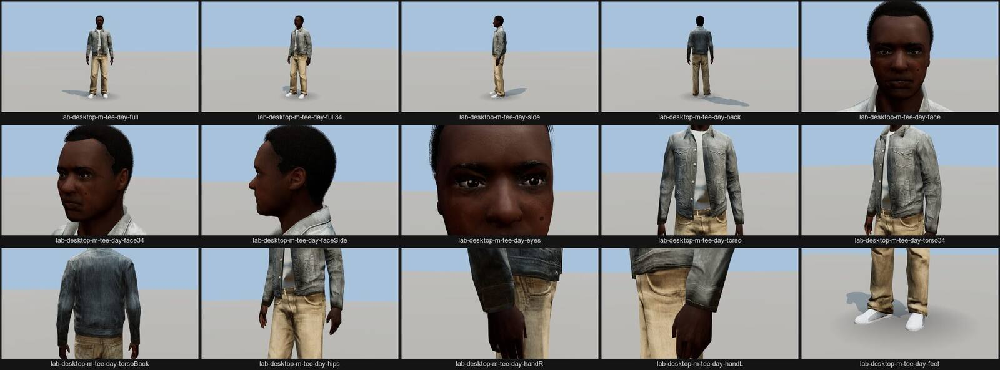
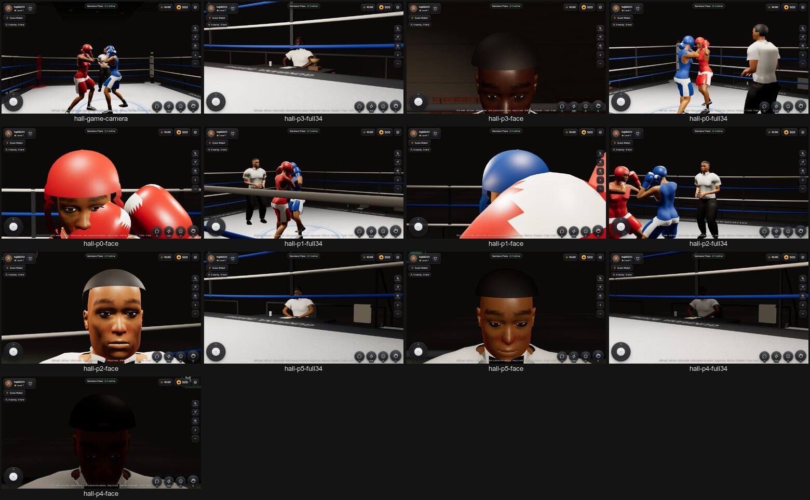

# Human realism — baseline (before P3-FGT-15)

Rubric: [docs/HUMAN-REALISM-RUBRIC.md](../../HUMAN-REALISM-RUBRIC.md) (0–5 per criterion, pass bar 4, score = min(auto,
visual)). Code: main at `c17eedc` (Rocketbox plaza avatar, P3-FGT-14 ring people). Tooling: `qa/e2e/human-assess/`
(quick runs of every section). Data: [baseline/metrics.json](baseline/metrics.json), visual scores
[baseline/scores.json](baseline/scores.json), report `baseline/realism-report.json`, sheets in `baseline/sheets/`.

Notes on this baseline: foot sliding was measured on the ankle (before the toe-bone method), which over-reports a
little; the boxing lab freezes motion, so boxer motion / eyes are not measured there (the hall run measures them);
the skin tone-fidelity numbers were added after this run (the dark-skin cheek L* was 8.8 vs ≈ 15 for its albedo).

## Scores

| Criterion         | Plaza person                                                              | Boxers | Ring people                                                |
| ----------------- | ------------------------------------------------------------------------- | ------ | ---------------------------------------------------------- |
| Proportions       | 4 (7.0–7.6 heads, segments ≤ 11 %)*                                       | –      | –                                                          |
| Face              | 2                                                                         | 2      | 2                                                          |
| Eyes              | 2 (blinks 15/min, saccades 45/min)                                        | 1      | –                                                          |
| Skin              | 2                                                                         | 1      | 1                                                          |
| Hair              | 2                                                                         | 1      | –                                                          |
| Hands and fingers | 2 (5×3 bones, paddle mesh)                                                | 3      | 5 auto                                                     |
| Clothing          | 2 (clothes = body surface)                                                | 2      | 2 (3–8 % of garment vertices inside the body, worst 39 mm) |
| Motion            | 2 (feet slide 3.6–7.5 cm per step at 1.4 m/s)                             | 3      | –                                                          |
| Expressions       | 2                                                                         | 3      | –                                                          |
| Lighting response | 3                                                                         | –      | –                                                          |
| LOD transitions   | 4 (head detail switch at 9 m, no measurable pop)                          | –      | –                                                          |
| Performance       | 3 (≤ 29k tris, 11 calls incl. shadow + props, 24 MB textures / body type) | 5      | 5                                                          |

Nothing passes except proportions and LOD; every subject is a 1–3 ("stylised-realistic game avatar"). (* re-scored with the joint-centre segment references of round 1; the first scoring used surface-landmark ratios and gave 3.)

## Top gaps (ranked)

1. **Skin is plastic / flat** on the ring people (one colour, rim-light SSS) and crushed on the darkest plaza tone.
2. **Clothes**: the plaza clothes are the body surface; the ring people's garments are body-offset shells that print
   the chest and let the body through (3–8 % of garment vertices inside, up to 4 cm).
3. **Faces and eyes**: generic low-detail heads, procedural / flat eyes, no lid occlusion or wet line.
4. **Hair**: helmet bowls (ring) and floating ribbon cards (plaza braids).
5. **Feet slide** at slow walking on the plaza (3–8 cm per step).
6. **Hands**: faceted paddles at close range; a pink wedge at the plaza wrist under the cuff.

P3-FGT-15 targets 1–4 for the ring people; round 1 measures what it changed.

