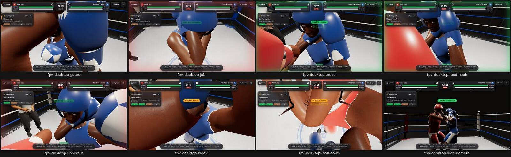
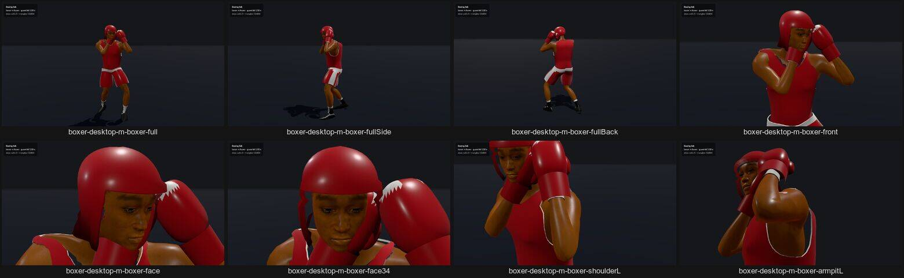
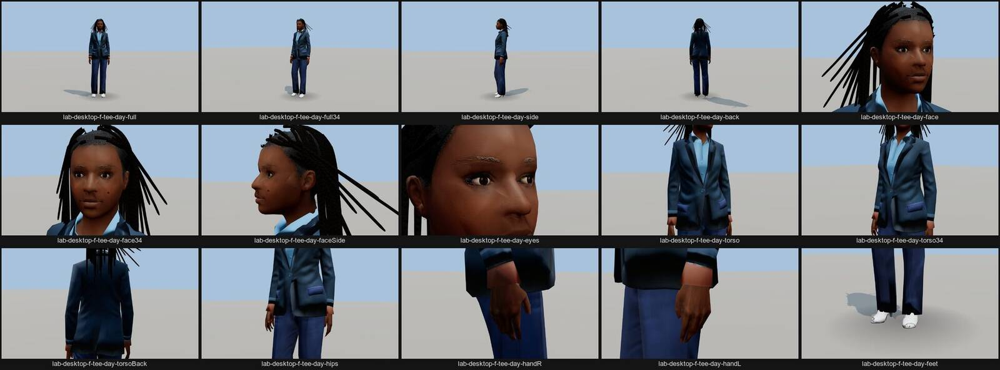
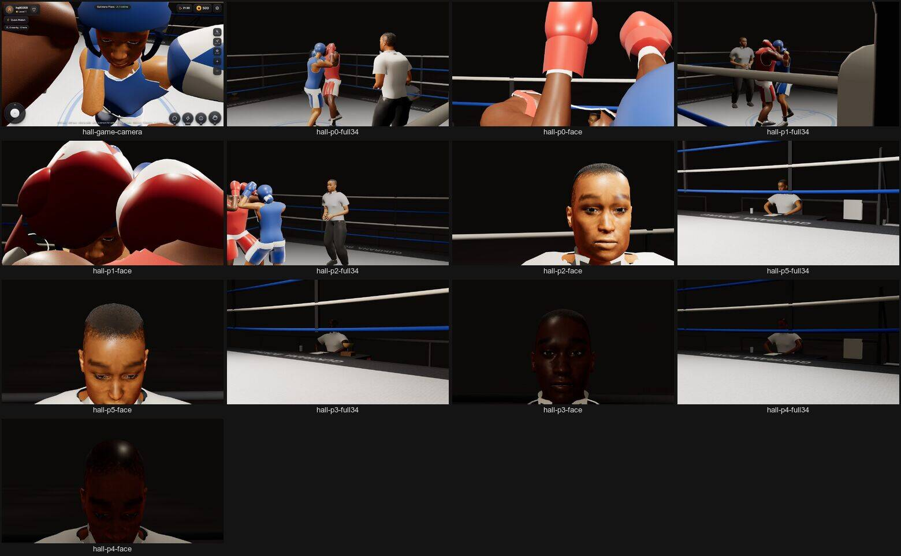

# Human realism — round 1 (main with P3-FGT-15 and P2-WLD-21)

Rubric: [docs/HUMAN-REALISM-RUBRIC.md](../../HUMAN-REALISM-RUBRIC.md) (0–5, pass bar 4, score = min(auto, visual)).
Code: main at `4d3f16e` merged into this branch (P3-FGT-15 realistic ring humans + first person, P2-WLD-21 night
lighting). Full run of `qa/e2e/human-assess/assess.mjs` (every section, desktop 1280×720 + phone 844×390): data
[round-1/metrics.json](round-1/metrics.json), visual scores [round-1/scores.json](round-1/scores.json), report
`round-1/realism-report.json`, sheets `round-1/sheets/`.

## Scores vs pass bar (4)

| Criterion         | Plaza person (Rocketbox)                                                | Boxers (new human)                                                          | Ring people (hall)        | First person |
| ----------------- | ----------------------------------------------------------------------- | --------------------------------------------------------------------------- | ------------------------- | ------------ |
| Proportions       | **4** (7.0–7.6 heads, segments ≤ 11 %)                                  | 2 auto* / 4 visual                                                          | –                         | –            |
| Face              | 2                                                                       | 3                                                                           | 3                         | –            |
| Eyes              | 2 (auto 5: 18 blinks/min, 18 saccades/min)                              | 3                                                                           | –                         | –            |
| Skin              | 2 (auto 2: 21 of 60 cheek patches off)                                  | 3                                                                           | 3                         | –            |
| Hair              | 2                                                                       | 3                                                                           | –                         | –            |
| Hands and fingers | 2 (auto 5: 5 × 3)                                                       | 3                                                                           | 5 auto                    | –            |
| Clothing          | 2 (clothes = body surface)                                              | 2 (2–3.4 % of garment vertices inside the body at rest, 5–9 % in the guard) | 2 (3–8 %, worst 40 mm)    | –            |
| Motion            | 3 (planted foot drifts 1.7–3.0 cm per step at 1.4 m/s; ≤ 1.6 cm faster) | 3                                                                           | –                         | –            |
| Expressions       | 2                                                                       | 3                                                                           | –                         | –            |
| Lighting response | 3                                                                       | 3                                                                           | 2 (judges black at night) | –            |
| LOD transitions   | **4** (pop −1.4 at the 9 m switch, 260 px)                              | –                                                                           | –                         | –            |
| Performance       | **4** (≤ 58k tris up close, 4–7 calls with shadow, 24 MB per body type) | **4** (26–29k tris, one mesh, 24 MB shared)                                 | 5 auto                    | –            |
| First-person view | –                                                                       | –                                                                           | –                         | 2            |

\* the boxers' head height was measured with the headgear on (it covers the skull skin): re-measured without it from
round 2; the everyday bodies on the same human measure 7.7–7.9 heads.

P3-FGT-15 clearly lifted the ring people (skin 1 → 3, eyes 1 → 3, hair 1 → 3, face 2 → 3) — a stylised game avatar
became a "convincing at gameplay distance" person. Nothing reaches 4 except proportions / LOD / performance.

## Ranked gaps and root causes

1. **First person (2)** — own-body slivers and cut edges along the bottom of the frame, the opponent's gloves filling
   most frames at clinch range, the phone guard frame showing only my own arm / glove. The lens check finds my own
   headgear trim, teeth and skin within 2–20 cm of the lens in the lead hook and look-down frames (the hide sphere and
   near cut leave the jaw / shoulder and headgear straps). Root cause: the camera sits inside a full-body mesh; the
   cut-away is a sphere plus a 16 cm near cut, so whatever crosses its edge is drawn as a cut shell. **Not default
   until it passes** (coordinator's rule): side broadcast camera becomes the default, first person stays an option.
2. **Clothing (2)** — ring people: the referee collar sits up to 13 mm inside the neck, shoes inside the feet, sleeves
   / tee inside the forearm in the guard (the arms press into the chest by 1–4 cm); jagged vest armholes; flat
   two-triangle bow tie; headgear and gloves are smooth glossy shells with a saw-tooth white knuckle target. Plaza:
   the clothes are the Rocketbox body surface. Root causes: garment shells built per body slice (build.mjs) with
   fixed offsets, no collision with the posed arms; procedural kit shading (one clearcoat lobe at roughness 0.25 =
   plastic); per-vertex slot boundaries on a coarse mesh.
3. **Skin / lighting on the plaza (2–3)** — the darkest tones lose all form at sunset / night, the lightest tone reads
   porcelain, light faces get black eye sockets under the night lamp; one roughness everywhere. Root cause: Rocketbox
   photo albedo with baked light, no skin shader. The ring skin is better but too polished on dark tones (rough 0.3–0.75
   plus a 0.12 clearcoat at rest).
4. **Faces / eyes (2–3)** — generic heads (MakeHuman sculpt / Rocketbox); boxers' lashes render as a dark stippled
   comb under the eye; no lid shadow on the eyeball, no wet line. Root cause: no scanned head; the lash helper drawn
   as noise strands top and bottom.
5. **Hair (plaza 2)** — braids stand out from the head like spokes. Root cause: the "off the face" sweep is added at
   full strength at every step of the strand (hair.ts), so it outweighs gravity.
6. **Motion (3)** — planted feet drift 1.7–3 cm per step at slow walking on the plaza (no foot locking).
7. **Hands (2–3)** — plaza: faceted paddles and a lighter band at the wrist where the hand texture meets the arm.
8. **Ring lighting at night (2)** — the judges' tables are nearly black at 21:30 in the hall (outside this task's
   scope: P2-WLD-21 lighting; reported to the coordinator).

## Round-1 fixes (assessed in round 2)

- Fight camera: the side broadcast camera is the default; first person stays an option (camera button / settings)
  behind `NEXT_PUBLIC_FF_FIGHT_FPV` (`fight/ui-store.ts`).
- Leather kit (`boxer-material.ts`): gloves, headgear, boots and shoes get matte waxed leather (roughness 0.5–0.6, a
  weak 0.1 clearcoat at 0.45 instead of 0.35 at 0.25), a padded undulation and a pebble grain in the normal, tonal
  mottling; the glove's knuckle panel a darker shade of the glove instead of a saw-tooth white patch.
- Eyes: upper-lid occlusion over the top of the eyeball and darker corners; lashes on the upper lid only, finer and
  sparser, soft brown-black (no comb under the eye).
- Skin: rougher at rest (0.42–0.8), the oily lobe 0.06 at rest (still grows with sweat).
- Plaza walking: foot locking (`world/human/foot-lock.ts`, two-bone IK pinning the planted ball of the foot, eased out
  on lift; unit-tested), people within 25 m.
- Plaza braids / locs: the sweep fades along the strand so they fall with gravity, and rest on the shoulders / upper
  back (an ellipse of the upper torso) instead of passing through.
- Tooling: the skin check now compares the cheek with a matte reference sphere in the skin's own albedo under the
  same light (exposure-independent); boxer proportions measured without headgear; segment references corrected to
  joint-centre lengths (de Leva 1996).

