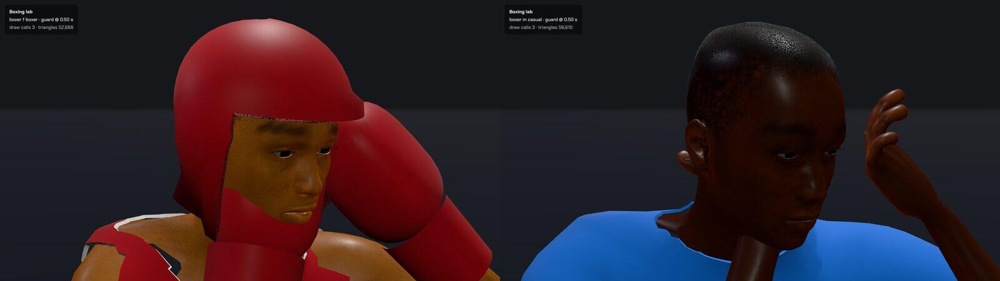
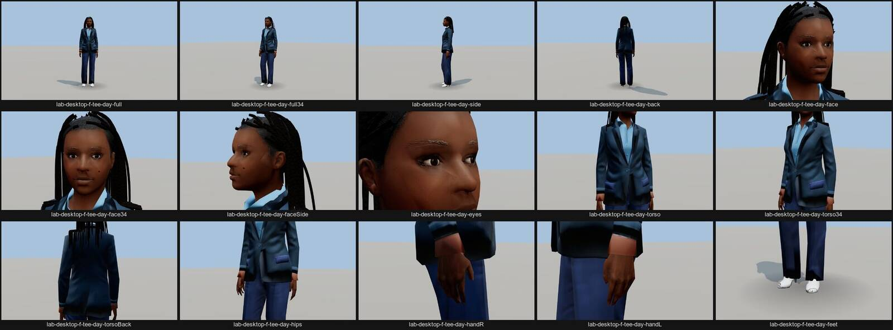
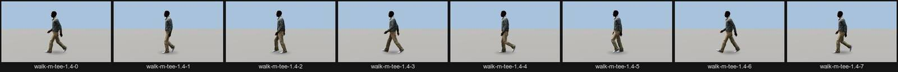

# Human realism — round 2

Assessed: the round-1 fixes (commit `4bea1fc`) plus the round-2 fixes below, full run of every section (desktop +
phone). Data [round-2/metrics.json](round-2/metrics.json), visual scores [round-2/scores.json](round-2/scores.json),
report `round-2/realism-report.json`, sheets `round-2/sheets/`.

## Fixes measured in this round

Round 1 (see round-1.md): side camera the default, leather kit, eyeball lid shadow / upper lashes, rougher skin, plaza
foot locking, braids with gravity, assessment upgrades.

Round 2:

- **Garments never inside the drawn skin** (`world/human/boxer/depenetrate.ts`, unit-tested): after the body type is
  baked and the covered body faces dropped, each garment vertex under (or within 2 mm of) the nearest drawn skin
  vertex is pushed out along that skin normal (bind space, once per build, capped at 3.5 cm so an arm against the chest
  is left alone).
- **First person**: my own headgear, hair, eyes, lashes and teeth are never drawn in first person; the near cut of my
  shoulders / straps widened from 16 to 22 cm.
- Assessment: garment penetration broken down per material slot; first-person check aware of the slots first person
  drops; boxer rest-pose clothing ignores the gloves / wraps (the bind pose's open hand inside a fist-shaped glove);
  the clothing score of live poses uses a looser bar than the rest pose.

## Scores vs pass bar (4)

| Criterion         | Plaza person                                             | Boxers                                                                            | Ring people                           | First person    |
| ----------------- | -------------------------------------------------------- | --------------------------------------------------------------------------------- | ------------------------------------- | --------------- |
| Proportions       | **4**                                                    | **4** (7.7–7.9 heads without headgear)                                            | –                                     | –               |
| Face              | 2                                                        | 3                                                                                 | 3                                     | –               |
| Eyes              | 2                                                        | 3                                                                                 | –                                     | –               |
| Skin              | 2 (auto 4: 57 of 60 patches within the albedo reference) | 3                                                                                 | 3                                     | –               |
| Hair              | 3 (was 2)                                                | 3                                                                                 | –                                     | –               |
| Hands and fingers | 2                                                        | 3                                                                                 | 5 auto                                | –               |
| Clothing          | 2                                                        | 3 (was 2: rest 0.1–0.2 % inside for tee / shirt / polo, was 2–3.4 %; guard 5–7 %) | 3 (was 2: referee / judges 0.3–0.9 %) | –               |
| Motion            | **4** (was 3: 0.1–0.2 cm per step, was 1.7–3.0)          | 3                                                                                 | –                                     | –               |
| Expressions       | 2                                                        | 3                                                                                 | –                                     | –               |
| Lighting response | 3                                                        | 3                                                                                 | 2                                     | –               |
| LOD transitions   | **4**                                                    | –                                                                                 | –                                     | –               |
| Performance       | **4**                                                    | **4**                                                                             | 5 auto                                | –               |
| First-person view | –                                                        | –                                                                                 | –                                     | 2 (option only) |

Perf: plaza scene 230–276 draw calls / 1.09–1.14 M triangles (desktop / phone), unchanged by the fixes; the boxing
hall 24 calls / 103k triangles from the side camera.

## Remaining gaps (ranked) and root causes

1. **Plaza person on Rocketbox** (face / skin / hands / clothing / expressions at 2): the base model itself — single-mesh
   clothes, baked-light photo albedo, low-detail heads and hands. Fix = migrate to the P3-FGT-15 human (see
   round-3.md, "what it would take").
2. **Boxers' arms sink into their own vest / tee in the guard** (5–7 % of garment vertices): the arm keep-out radii
   (boxing/rig.ts) are set against the bare torso slices; the clothes stand 1.5–2 cm off the body.
3. **First person (2)**: cut shells of my own jaw / mouth in the uppercut, gloves filling the frame at clinch range;
   needs a real first-person viewmodel.
4. **Faces, eyes, skin up close (3)**: generic sculpt, no wet line, single 2K body map — scanned heads / paid assets.
5. **Gloves / headgear shape (3)**: procedural smooth shells (no seams / stitching geometry); the knuckle panel boundary
   still shows the mesh's saw-tooth.
6. **Night in the boxing hall**: judges' faces nearly black (P2-WLD-21 domain).

