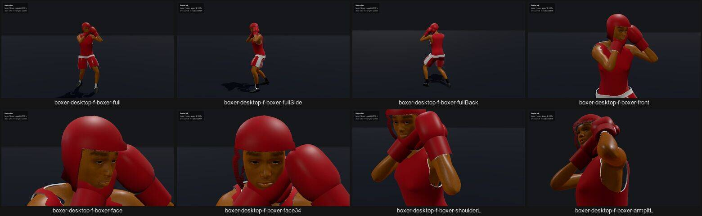
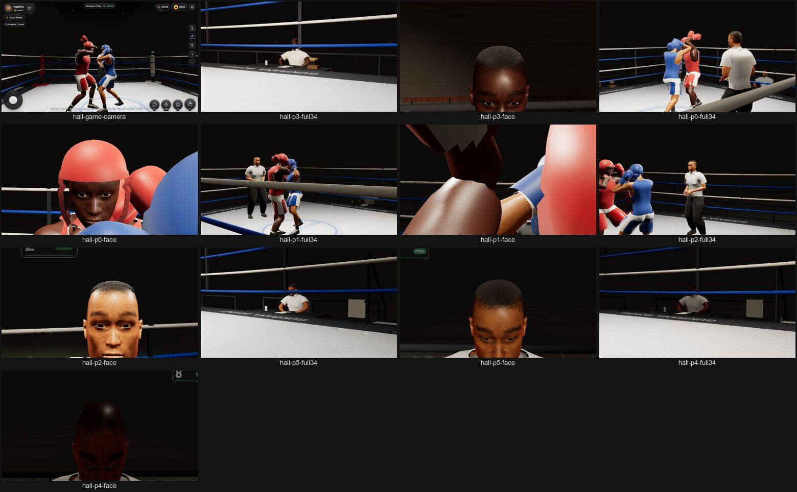
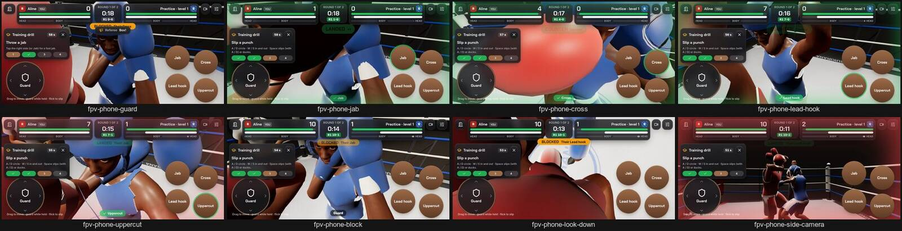

# Human realism — round 3 (final round of this task)

Assessed: round-2 state plus the round-3 fixes. Re-run: boxer lab, boxing hall and first person (desktop + phone);
plaza sections carried from round 2 (no plaza change this round). Data [round-3/metrics.json](round-3/metrics.json),
visual scores [round-3/scores.json](round-3/scores.json), report `round-3/realism-report.json`, sheets
`round-3/sheets/`. z-scan of the boxing hall: 0 overlapping flat / wall faces.

## Round-3 fixes

- **Arm keep-out carries the clothes' stand-off** (`world/human/boxing/rig.ts` KEEP: elbow 5 → 6.5 cm, upper arm
  4.5 → 6 cm, forearm 4.5 → 6.2 cm against the bare torso slices): in the guard the forearms no longer sink into the
  vest / tee — garment vertices inside the body 6.7 → 2.8 % (tee), 7.2 → 3.0 % (referee shirt), 5.4 → 4.5 % / 5.2 → 3.5 %
  (boxers; the rest is the glove cuff on the forearm). The motion library's own trunk / shoulder tests still pass.
- **Glove knuckle panel** in the glove's own leather (a 4 % darker shade): the mesh's saw-tooth slot boundary no longer
  shows.
- Tried and reverted: a head keep-out for the gloves (no measurable change: the glove's remaining penetration is the
  cuff on the forearm, not the face).

## Scores per round (pass bar 4)

| Criterion         | Plaza B → R1 → R2 → R3 | Boxers B → R1 → R2 → R3 | Ring people B → R1 → R2 → R3 | First person R1 → R2 → R3               |
| ----------------- | ---------------------- | ----------------------- | ---------------------------- | --------------------------------------- |
| Proportions       | 4 → 4 → 4 → **4**      | – → 2* → 4 → **4**      | –                            | –                                       |
| Face              | 2 → 2 → 2 → 2          | 2 → 3 → 3 → 3           | 2 → 3 → 3 → 3                | –                                       |
| Eyes              | 2 → 2 → 2 → 2          | 1 → 3 → 3 → 3           | –                            | –                                       |
| Skin              | 2 → 2 → 2 → 2          | 1 → 3 → 3 → 3           | 1 → 3 → 3 → 3                | –                                       |
| Hair              | 2 → 2 → 3 → 3          | 1 → 3 → 3 → 3           | –                            | –                                       |
| Hands and fingers | 2 → 2 → 2 → 2          | 3 → 3 → 3 → 3           | 5 auto                       | –                                       |
| Clothing          | 2 → 2 → 2 → 2          | 2 → 2 → 3 → 3           | 2 → 2 → 3 → 2–3†             | –                                       |
| Motion            | 2 → 3 → 4 → **4**      | 3 → 3 → 3 → 3           | –                            | –                                       |
| Expressions       | 2 → 2 → 2 → 2          | 3 → 3 → 3 → 3           | –                            | –                                       |
| Lighting response | 3 → 3 → 3 → 3          | – → 3 → 3 → 3           | – → 2 → 2 → 2                | –                                       |
| LOD transitions   | 4 → 4 → 4 → **4**      | –                       | –                            | –                                       |
| Performance       | 3 → 4 → 4 → **4**      | 5 → 4 → 4 → **4**       | 5 → 5 → 5 → **5**            | –                                       |
| First-person view | –                      | –                       | –                            | 2 → 2 → 2 (option; side camera default) |

B = baseline (before P3-FGT-15). \* round 1 measured the boxers' heads with the headgear on. † the live-fight
measurement depends on the pose caught (referee / judges 0.6–1.2 %, boxers 6.8–9.4 % in punches / clinches).

Passing (≥ 4): proportions, motion (plaza), LOD, performance. Everything else is at 2–3, and every one of those needs
something this assess-and-fix loop cannot deliver in place: a migration of the plaza person to the new human, paid
scanned assets, or a renderer feature over the phone budget. That is the stop condition (rather than a 4th round of
diminishing tweaks).

## What it would take to pass (remaining gaps)

| Gap                                                                          | Score now | What closes it                                                                                                                                                                                                                                                                                                                                                                                                                                                                                                                                                                                                                                                                                                                                                                                                                                                                                                                                                                                                     | Inside the constraints?                                                                             | Effort                                                            | Expected gain                                                                                                           |
| ---------------------------------------------------------------------------- | --------- | ------------------------------------------------------------------------------------------------------------------------------------------------------------------------------------------------------------------------------------------------------------------------------------------------------------------------------------------------------------------------------------------------------------------------------------------------------------------------------------------------------------------------------------------------------------------------------------------------------------------------------------------------------------------------------------------------------------------------------------------------------------------------------------------------------------------------------------------------------------------------------------------------------------------------------------------------------------------------------------------------------------------ | --------------------------------------------------------------------------------------------------- | ----------------------------------------------------------------- | ----------------------------------------------------------------------------------------------------------------------- |
| Plaza person on the Rocketbox base (face, skin, hair, hands, clothing all 2) | 2         | Migrate the plaza avatar to the P3-FGT-15 human: (1) retarget the Rocketbox walk / life / seated / emote clips onto the MakeHuman rig (same Bip01 names, different rest pose: a per-bone rest-offset retarget, then re-check every seat profile and hand-rest layer), (2) map the 30+ outfit items to draped garments in build.mjs (tops: tee / hoodie / jersey / track / blazer / kitenge / imigongo / mushanana / sash; bottoms: jeans / joggers / shorts / chinos / skirts / wraps; shoes; headwear) — each a garment shell + slot + colour uniform, (3) rebuild the 18 hair styles as strands / cards on the new scalp (hair.ts already generates strands procedurally: re-fit to the MakeHuman head), (4) face sliders (face.ts) onto the MakeHuman face targets, (5) crowd LOD: a 6–8k-tri decimated LOD1 and impostors beyond 30 m to keep the 250-draw-call plaza budget (today 12–29k tris per Rocketbox person), (6) look-code migration (codes stay valid: the look is data, only the renderer changes) | Yes (all CC0 / MIT, in-house)                                                                       | 2–3 weeks (one agent), behind a feature flag with side-by-side QA | Plaza face 2→3, skin 2→3, hair 2→3, clothing 2→3, hands 2→3 (to the ring people's level)                                |
| Faces at head-and-shoulders (all 3)                                          | 3         | Scanned heads (3D scan store, game licence) or Reallusion CC4 + Headshot with an Enterprise licence for in-game customisation, retopologised to the MakeHuman topology so the rig, morphs and garments keep working; 1K face-only detail maps (desktop), 512 px on phones                                                                                                                                                                                                                                                                                                                                                                                                                                                                                                                                                                                                                                                                                                                                          | Needs a paid asset (≈ USD 50–300 per head, or CC4 ≈ USD 300 + Enterprise licence for customisation) | 2–4 days per head incl. retopo / bake                             | Face 3→4 for the hero people (referee, coaches, AI opponents); the player's own customisable face stays on the CC0 base |
| Skin up close (3)                                                            | 3         | Screen-space SSS on desktop only (a separable blur on a skin mask, ~1.5 ms at 1080p) + 4K face detail; phones keep the wrap-lighting approximation                                                                                                                                                                                                                                                                                                                                                                                                                                                                                                                                                                                                                                                                                                                                                                                                                                                                 | Desktop yes; phones no (budget)                                                                     | 3–4 days                                                          | Skin 3→4 on desktop                                                                                                     |
| Eyes (3)                                                                     | 3         | A parallax / refraction iris and a lower-lid tear line mesh (eye "occlusion" mesh as in MetaHuman-style rigs, built in build.mjs)                                                                                                                                                                                                                                                                                                                                                                                                                                                                                                                                                                                                                                                                                                                                                                                                                                                                                  | Yes                                                                                                 | 1–2 days                                                          | Eyes 3→4                                                                                                                |
| Hair (3)                                                                     | 3         | Strand cards with alpha-to-coverage and Kajiya-Kay highlights for the longer styles; the close crop is already strands                                                                                                                                                                                                                                                                                                                                                                                                                                                                                                                                                                                                                                                                                                                                                                                                                                                                                             | Yes                                                                                                 | 3–5 days                                                          | Hair 3→4 for long styles                                                                                                |
| Clothing folds / cloth in motion (2–3)                                       | 2–3       | Static drape → baked fold normal maps per garment (CC0 fabric scans) + per-pose corrective shapes; real simulation is out of the phone budget                                                                                                                                                                                                                                                                                                                                                                                                                                                                                                                                                                                                                                                                                                                                                                                                                                                                      | Yes (static), no (sim)                                                                              | 3–5 days                                                          | Clothing 3→4 at rest; motion clipping needs pose keep-outs per outfit                                                   |
| First-person view (2)                                                        | 2         | A proper first-person "viewmodel": a separate arms-and-gloves mesh drawn in its own pass with its own near plane (no head, jaw, shoulders or straps in the lens by construction), the body for look-down only, a stand-off distance kept from the opponent in first person (no clinch-range framing), a narrower phone lens                                                                                                                                                                                                                                                                                                                                                                                                                                                                                                                                                                                                                                                                                        | Yes                                                                                                 | 3–5 days                                                          | FPV 2→4, then it can be the default again                                                                               |
| Expressions (2–3)                                                            | 2–3       | ARKit-style 52 blend shapes on the MakeHuman head (generated from the MakeHuman expression targets, CC0) driven by intent; the plaza needs the migration first                                                                                                                                                                                                                                                                                                                                                                                                                                                                                                                                                                                                                                                                                                                                                                                                                                                     | Yes                                                                                                 | 3–4 days                                                          | Expressions 3→4                                                                                                         |
| Night lighting in the boxing hall (judges black at 21:30)                    | 2         | Task lights on the judges' tables / a hall wash at night (P2-WLD-21's domain)                                                                                                                                                                                                                                                                                                                                                                                                                                                                                                                                                                                                                                                                                                                                                                                                                                                                                                                                      | Yes                                                                                                 | < 1 day                                                           | Lighting 2→3/4 for the ring people                                                                                      |

Perf after the fixes: plaza 230–276 draw calls / 1.09–1.14 M triangles (desktop / phone); a ring person 26–29k
triangles in one skinned mesh, 24 MB of shared textures; foot locking costs two leg IK solves per person within 25 m;
the garment de-penetration runs once per body build.

